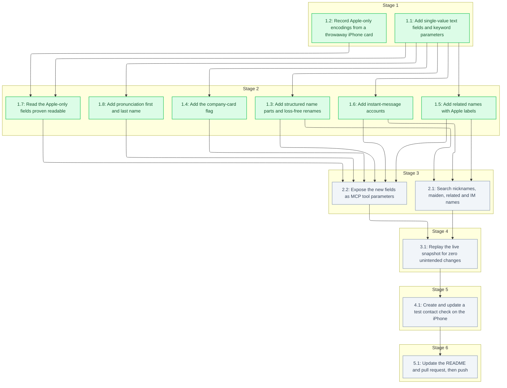

# Tasks: Contact Fields Completion

<!-- spec-nav:start -->
**Spec navigation:** [State](00_state.md) · [Discovery](01_discovery.md) · [Requirements](02_requirements.md) · [Design](03_design.md) · [Tasks](04_tasks.md) · [Execution](05_execution.md)
<!-- spec-nav:end -->

## Stage and Dependency Overview

> [!WARNING]
> Execute dependency stages in order. Every task here is sequential, because they share [`src/icloud_mcp/contacts.py`](../../src/icloud_mcp/contacts.py) and its tests. Stop at the checkpoint before the MCP server writes anything to the user's iCloud account. Task 1.2's throwaway card, created on the iPhone through iPhone Mirroring that the user allowed for testing, is the one earlier write.

## Checklist

- [x] 1. Field model in the contacts module
  - [x] 1.1 Add single-value text fields and keyword parameters
    - Add keyword-only parameters to `_apply_fields` exactly as in the design signature, all defaulting to `None`.
    - Add `_set_text_property(vcard, prop_name, value)`: `None` leaves the field alone, `""` removes every instance, and text replaces it.
    - Add `_set_org(vcard, organization, department)`.
      - It replaces only components 0 and 1, keeps components from index 2 on, and drops trailing empty components.
      - It removes `ORG` when every component is empty.
      - It always assigns a list.
    - Add `_validate_fields(vcard, **fields)` as the first step of `_apply_fields`. It mutates nothing, and later tasks add their checks to it.
    - Read `phonetic_first_name`, `phonetic_middle_name`, `phonetic_last_name`, `nickname`, `maiden_name`, `department` and `phonetic_organization` in `_vcard_to_dict`, each `""` when absent.
    - Pass the new keywords through `create_contact` and `update_contact`.
    - **Files:** [`src/icloud_mcp/contacts.py`](../../src/icloud_mcp/contacts.py), [`tests/test_contacts.py`](../../tests/test_contacts.py)
    - **Dependency resolution:** none
    - **Dependency delivery:** none
    - **Depends on:** none
    - **Stage:** 1
    - **Interfaces:** Consumes: the design's `_apply_fields` keyword-only signature and the property table (`X-PHONETIC-FIRST-NAME`, `X-PHONETIC-MIDDLE-NAME`, `X-PHONETIC-LAST-NAME`, `NICKNAME`, `X-MAIDENNAME`, `ORG` second component, `X-PHONETIC-ORG`); Produces: `_set_text_property(vcard, prop_name: str, value: str | None) -> None`, `_set_org(vcard, organization: str | None, department: str | None) -> None`, the seven new read keys, and `create_contact`/`update_contact` accepting them as keywords
    - **Documentation:** docstrings for `_set_text_property` and `_set_org` stating the `None` / `""` / text contract and why the department survives organization updates
    - **Verification:** `.venv/bin/pytest -q` passes, with new tests for each field's read, set, clear and omit, and for an organization update keeping the department, an `ORG:Acme;Eng;Platform` update keeping `Platform`, and an organization containing `;` round-tripping; `.venv/bin/ruff check src tests` is clean; the docstrings are reviewed
    - **Estimated effort:** 45–75 minutes
    - **Risk:** low; additive, and existing positional callers stay valid
    - **Task category:** code_analysis
    - **Delegation:** sequential subagent
    - _Requirements: 2.1, 2.2, 2.3, 3.1, 3.2, 3.3, 3.4, 8.1, 8.2_
  - [x] 1.2 Record Apple-only encodings from a throwaway iPhone card
    - Through iPhone Mirroring, create a contact named `ZZ MCP Fields Test` in the iPhone's Contacts app. Give it a birthday in another calendar, a non-default ringtone and text tone, and a verification code. Note what the card shows.
    - Fetch its vCard over CardDAV with a read-only GET and record each property's exact encoding.
    - Fill in Appendix A of [03_design.md](03_design.md). For each field record the encoding, what the iPhone shows, and a readable or not-readable decision: readable only when the shown value derives from the stored value without device-only data.
    - Leave the card for the user to delete. Never touch any other contact.
    - **Files:** [`.specs/contact-fields-completion/03_design.md`](03_design.md), [`.specs/contact-fields-completion/execution/format-investigation.md`](execution/format-investigation.md)
    - **Dependency resolution:** none
    - **Dependency delivery:** none
    - **Depends on:** none
    - **Stage:** 1
    - **Interfaces:** Consumes: iPhone Mirroring access granted by the user, and CardDAV read access through the project's local credentials file; Produces: a completed Appendix A table (field, stored property and parameters, iPhone display, decision) and [`execution/format-investigation.md`](execution/format-investigation.md) containing the throwaway card's masked vCard lines
    - **Documentation:** no public surface; Appendix A records each decision and its rationale
    - **Verification:** Appendix A has a decision for all four fields; the recorded vCard lines come from the `ZZ MCP Fields Test` card only; no other contact was modified (a pre/post snapshot of the people count and of the other cards' ETags matches)
    - **Estimated effort:** 30–60 minutes
    - **Risk:** medium; a UI slip could edit a real contact, so the card is created through the "+" button and the edit is checked before saving
    - **Task category:** review
    - **Delegation:** controller
    - _Requirements: 7.1_
  - [x] 1.3 Add structured name parts and loss-free renames
    - Add `_parse_name_parts(vcard) -> dict[str, str]` returning `prefix`, `first_name`, `middle_name`, `last_name` and `suffix`, joining multi-value `N` components with a space.
    - Add `_apply_name(vcard, name, parts)` implementing the design's four rules: structured parts given; only `name` given (token stripping for the stored prefix, suffix and contiguous middle name); parts changed without `name` (recompute `FN`); both given.
      - A `name` or part equal to the current read is treated as omitted.
      - Parts are mutated in place on the existing `N`, so multi-value parts that were not provided stay intact.
      - `N` is created when absent.
    - Make `create_contact`'s `name` optional. Raise `ValueError("contact needs a name, a name part or an organization")` as its first statement, before `require_auth` and any discovery request, when none is given. Remove the old `fn`/`n` construction from `create_contact`.
    - Replace the `_split_name`-based rename in `update_contact` with `_apply_name`.
    - **Files:** [`src/icloud_mcp/contacts.py`](../../src/icloud_mcp/contacts.py), [`tests/test_contacts.py`](../../tests/test_contacts.py)
    - **Dependency resolution:** none
    - **Dependency delivery:** none
    - **Depends on:** 1.1
    - **Stage:** 2
    - **Interfaces:** Consumes: `_apply_fields` keyword-only parameters `name`, `prefix`, `first_name`, `middle_name`, `last_name`, `suffix` from task 1.1; Produces: `_parse_name_parts(vcard) -> dict[str, str]`, `_apply_name(vcard, name: str | None, parts: dict[str, str | None]) -> None`, `create_contact(name: str | None = None, …)` and the five name keys on reads
    - **Documentation:** docstrings for `_apply_name` stating the four rules and why stored parts survive a display-name rename; docstring update for `create_contact`
    - **Verification:** `.venv/bin/pytest -q` passes with tests for:
      - each rule;
      - a rename of `Dr. Jane Q Doe PhD` to `Dr. Janet Q Doe PhD` keeping the prefix, middle name and suffix;
      - a single-token name;
      - clearing a part with `""`;
      - the display name recomputed from parts;
      - a create with no identity raising before any network call (`requests.Session.request` patched to fail);
      - a write-back of the read `name` and parts leaving `N`/`FN` byte-identical for an empty-`FN` card, a company card and `N:Doe;John;A,B;Dr.;Jr.,PhD`;
      - a multi-word family name such as `de la Cruz` surviving a write-back.
      Also: `ruff` is clean, and the docstrings are reviewed.
    - **Estimated effort:** 60–90 minutes
    - **Risk:** medium; it changes rename behaviour for every contact, and rollback is reverting the commit
    - **Task category:** heavy_reasoning
    - **Delegation:** sequential subagent
    - _Requirements: 1.1, 1.2, 1.3, 1.4, 1.5, 1.6, 1.7, 8.2_
  - [x] 1.4 Add the company-card flag
    - Add `_set_company_flag(vcard, is_company)`: `True` adds `X-ABShowAs:COMPANY`, `False` removes it only when its value is `COMPANY`, and `None` or a value equal to the current read leaves it alone.
    - Read `is_company` as a boolean in `_vcard_to_dict`.
    - Raise `ValueError("is_company needs an organization")` in `_validate_fields` when `is_company=True` and the resulting organization would be empty.
    - **Files:** [`src/icloud_mcp/contacts.py`](../../src/icloud_mcp/contacts.py), [`tests/test_contacts.py`](../../tests/test_contacts.py)
    - **Dependency resolution:** none
    - **Dependency delivery:** none
    - **Depends on:** 1.1
    - **Stage:** 2
    - **Interfaces:** Consumes: the `_apply_fields(..., is_company=...)` keyword and `_set_org` from task 1.1; Produces: `_set_company_flag(vcard, is_company: bool | None) -> None` and the `is_company: bool` read key
    - **Documentation:** docstring for `_set_company_flag` explaining Apple's `X-ABShowAs` semantics
    - **Verification:** `.venv/bin/pytest -q` passes with tests for:
      - reading true and false, and case-insensitive reads;
      - setting and unsetting the flag;
      - the no-organization error;
      - an unchanged `true` echo on a company card that has an organization making no change.
      Also: `ruff` is clean, and the docstrings are reviewed.
    - **Estimated effort:** 30–50 minutes
    - **Risk:** low
    - **Task category:** code_analysis
    - **Delegation:** sequential subagent
    - _Requirements: 3.1, 3.5, 3.6, 3.7_
  - [x] 1.5 Add related names with Apple labels
    - Add `_parse_related_names(vcard)` returning `{label, name}` entries, with labels decoded through `_decode_label`.
    - Add `_set_related_names(vcard, items)`, which replaces the list as a whole.
      - Entries are matched on the exact stripped name, without `_normalized`. A matching entry whose label is omitted or equal is re-added verbatim. A relabelled entry keeps `pref`.
      - Groups of removed entries stay reserved, through a new `reserved` argument to `_next_group`.
      - New entries without a label get `other`.
      - Labels matching the design's built-in list are written as `_$!<Token>!$_`, and anything else as custom text, through `_set_typed_label`.
    - Raise `ValueError("related name entry needs a name: <entry>")` in `_validate_fields` for an empty name. Validation and the default label apply only to entries that match no stored entry.
    - **Files:** [`src/icloud_mcp/contacts.py`](../../src/icloud_mcp/contacts.py), [`tests/test_contacts.py`](../../tests/test_contacts.py)
    - **Dependency resolution:** none
    - **Dependency delivery:** none
    - **Depends on:** 1.1
    - **Stage:** 2
    - **Interfaces:** Consumes: the `_apply_fields(..., related_names=...)` keyword from task 1.1, plus the existing `_set_typed_label`, `_decode_label` and `_remove_orphan_groups`; Produces: `_parse_related_names(vcard) -> list[dict[str, str]]`, `_set_related_names(vcard, items: list[dict[str, str]]) -> None` and the `related_names` read key
    - **Documentation:** docstrings stating the entry shape, the built-in label list and the verbatim-echo rule
    - **Verification:** `.venv/bin/pytest -q` passes with tests for:
      - reading built-in and custom labels;
      - an unchanged echo being byte-identical;
      - adding, removing and relabelling;
      - the default label `other`;
      - the empty-name error;
      - a stored label line that is already damaged surviving an echo.
      Also: `ruff` is clean, and the docstrings are reviewed.
    - **Estimated effort:** 45–75 minutes
    - **Risk:** low
    - **Task category:** code_analysis
    - **Delegation:** sequential subagent
    - _Requirements: 4.1, 4.2, 4.3, 4.4, 4.5_
  - [x] 1.6 Add instant-message accounts
    - Add `_parse_instant_messages(vcard)` returning `{label, service, username}`.
      - `service` comes from `X-SERVICE-TYPE`, or from the URI scheme when that parameter is absent.
      - `username` is the value after the first colon, percent-decoded.
      - Labels come through `_HOME_WORK_OTHER`.
    - Add `_set_instant_messages(vcard, items)`, which replaces the list as a whole.
      - Entries are matched on (service, decoded username). A matching entry whose label is omitted or equal is re-added verbatim, including `X-BUNDLEIDENTIFIERS` and `X-TEAMIDENTIFIER`. A relabelled entry keeps `pref`.
      - New entries use the design's service and scheme table, with `x-apple:` for any other service.
      - New entries without a label get `other`.
    - Raise `ValueError("instant message entry needs a service and a username: <entry>")` in `_validate_fields`, only for entries that match no stored entry.
    - **Files:** [`src/icloud_mcp/contacts.py`](../../src/icloud_mcp/contacts.py), [`tests/test_contacts.py`](../../tests/test_contacts.py)
    - **Dependency resolution:** none
    - **Dependency delivery:** none
    - **Depends on:** 1.1
    - **Stage:** 2
    - **Interfaces:** Consumes: the `_apply_fields(..., instant_messages=...)` keyword from task 1.1, plus `_set_typed_label` and the design's service and scheme table; Produces: `_parse_instant_messages(vcard) -> list[dict[str, str]]`, `_set_instant_messages(vcard, items: list[dict[str, str]]) -> None` and the `instant_messages` read key
    - **Documentation:** docstrings stating the entry shape, the service and scheme mapping, and why app identifiers are kept only on unchanged entries
    - **Verification:** `.venv/bin/pytest -q` passes with tests for:
      - reading `skype:` and `x-apple:` values, a value with `%20`, an IMPP without `X-SERVICE-TYPE`, and `TYPE=HOME` reading as `home`;
      - an unchanged echo, including app identifiers, being byte-identical;
      - adding a Skype and an unknown-service account;
      - the validation error.
      Also: `ruff` is clean, and the docstrings are reviewed.
    - **Estimated effort:** 45–75 minutes
    - **Risk:** low
    - **Task category:** code_analysis
    - **Delegation:** sequential subagent
    - _Requirements: 5.1, 5.2, 5.3, 5.4_
  - [x] 1.7 Read the Apple-only fields proven readable
    - For each field that Appendix A marks readable, add a decoder in `_parse_apple_extras(vcard)` and include its key in `_vcard_to_dict` only when the value decodes.
    - Unit-test each decoder on the recorded throwaway values.
    - Fields marked not readable get no key. Record that in Appendix A, which closes their conditional criteria.
    - **Files:** [`src/icloud_mcp/contacts.py`](../../src/icloud_mcp/contacts.py), [`tests/test_contacts.py`](../../tests/test_contacts.py)
    - **Dependency resolution:** none
    - **Dependency delivery:** none
    - **Depends on:** 1.1, 1.2
    - **Stage:** 2
    - **Interfaces:** Consumes: the Appendix A decisions and recorded encodings from task 1.2, and `_vcard_to_dict` from task 1.1; Produces: `_parse_apple_extras(vcard) -> dict[str, Any]`, with only the confirmed keys among `alternate_birthday` (`{calendar, month, day, year}`), `ringtone` and `text_tone`
    - **Documentation:** docstring naming the confirmed encodings and why undecodable values are omitted
    - **Verification:** `.venv/bin/pytest -q` passes with tests for each confirmed decoder, an undecodable value being omitted, and pronoun data never appearing in reads; `ruff` is clean; the docstrings are reviewed
    - **Estimated effort:** 15–60 minutes
    - **Risk:** low; read-only
    - **Task category:** code_analysis
    - **Delegation:** sequential subagent
    - _Requirements: 6.4, 7.2, 7.3, 7.4, 7.5_

  - [x] 1.8 Add pronunciation first and last name
    - Add `pronunciation_first_name` → `x-pronunciation-first-name` and `pronunciation_last_name` → `x-pronunciation-last-name` to `_TEXT_FIELDS`, and expose them as keyword-only `_apply_fields` parameters.
    - **Files:** [`src/icloud_mcp/contacts.py`](../../src/icloud_mcp/contacts.py), [`tests/test_contacts.py`](../../tests/test_contacts.py)
    - **Dependency resolution:** none
    - **Dependency delivery:** none
    - **Depends on:** 1.1
    - **Stage:** 2
    - **Interfaces:** Consumes: `_TEXT_FIELDS`, `_set_text_property` and the `_apply_fields` keyword-only parameters from task 1.1; Produces: the `pronunciation_first_name` and `pronunciation_last_name` read keys and keyword parameters
    - **Documentation:** the `_TEXT_FIELDS` comment names the pronunciation properties and that they differ from the phonetic ones
    - **Verification:** `.venv/bin/pytest -q` passes with tests that read the recorded `X-PRONUNCIATION-*` lines and that set, clear, omit and echo them; `ruff` is clean
    - **Estimated effort:** 10–20 minutes
    - **Risk:** low
    - **Task category:** quick_lookup
    - **Delegation:** sequential subagent
    - _Requirements: 2.1, 2.2, 2.3_

- [ ] 2. Search and tool surface
  - [ ] 2.1 Search nicknames, maiden, related and IM names
    - Add `nickname`, `maiden_name`, every `related_names[].name` and every `instant_messages[].username` to the text `search_contacts` matches against.
    - **Files:** [`src/icloud_mcp/contacts.py`](../../src/icloud_mcp/contacts.py), [`tests/test_contacts.py`](../../tests/test_contacts.py)
    - **Dependency resolution:** none
    - **Dependency delivery:** none
    - **Depends on:** 1.3, 1.5, 1.6
    - **Stage:** 3
    - **Interfaces:** Consumes: the `nickname`, `maiden_name`, `related_names` and `instant_messages` read keys from tasks 1.1, 1.5 and 1.6; Produces: `search_contacts(query, limit)` matching those values case-insensitively
    - **Documentation:** update the `search_contacts` docstring listing the searched fields
    - **Verification:** `.venv/bin/pytest -q` passes, with a test per new searched field and a non-matching query returning nothing; `ruff` is clean
    - **Estimated effort:** 15–30 minutes
    - **Risk:** low
    - **Task category:** quick_lookup
    - **Delegation:** sequential subagent
    - _Requirements: 8.3_
  - [ ] 2.2 Expose the new fields as MCP tool parameters
    - Add each new writable key as an optional `Annotated[..., Field(description=...)]` parameter on `contacts_create` and `contacts_update`, and make `name` optional on `contacts_create`.
    - Update the `contacts_list` and `contacts_search` docstrings to list the new read keys.
    - In `_run`, map `requests.HTTPError` with status 412 by operation: the conflict message for `update_contact`, and `ToolError("a contact with this id already exists")` for `create_contact`.
    - In `update_contact`, refuse with `ValueError("iCloud returned no ETag for this contact; refusing an unconditional overwrite")` when the GET returned no ETag.
    - Pass the new fields to `_run` by keyword, from shared `Annotated` aliases.
    - Add tests that:
      - list the tool schema and check that each new key is present;
      - check that no Apple-only name is present and that calling with `pronouns` is rejected;
      - check the 412 mapping for update and for create through a stubbed session;
      - check that the PUT carries `If-Match` equal to the GET's ETag, and that a missing ETag is refused.
    - **Files:** [`src/icloud_mcp/server.py`](../../src/icloud_mcp/server.py), [`src/icloud_mcp/contacts.py`](../../src/icloud_mcp/contacts.py), [`tests/test_server.py`](../../tests/test_server.py)
    - **Dependency resolution:** none
    - **Dependency delivery:** none
    - **Depends on:** 1.3, 1.4, 1.5, 1.6, 1.7, 1.8
    - **Stage:** 3
    - **Interfaces:** Consumes: `create_contact` / `update_contact` keyword parameters from tasks 1.1–1.6 and the Current Technology Evidence decision (FastMCP 4.1.0 rejects unknown arguments); Produces: the `contacts_create` / `contacts_update` MCP schemas with the new optional parameters, and the HTTP 412 conflict `ToolError`
    - **Documentation:** each parameter's `Field(description=...)` states its shape and its `None` / `""` semantics; tool docstrings updated
    - **Verification:** `.venv/bin/pytest -q` passes, including the schema, extra-argument and 412 tests; `ruff` is clean; the parameter descriptions are reviewed; if fastmcp is no longer 4.1.0, redo the Context7 check
    - **Estimated effort:** 45–75 minutes
    - **Risk:** low; additive schema change
    - **Task category:** code_analysis
    - **Delegation:** sequential subagent
    - _Requirements: 1.7, 6.5, 8.1, 8.6_

- [ ] 3. Verification on real data
  - [ ] 3.1 Replay the live snapshot for zero unintended changes
    - Fetch a fresh read-only snapshot of the live iCloud address book, with every write method blocked.
    - Replay in memory:
      - a write-back of every field;
      - a single-field edit of each new field on every card that has it, or an add where none exists.
    - Assert 0 changed cards for the write-back, that only the edited field's lines change, and that every pronoun and ringtone line stays byte-identical.
    - Count, and assert no failures on:
      - company cards with an empty organization (expected 0);
      - IMPP lines without `X-SERVICE-TYPE`;
      - `ORG` values with three or more components;
      - unescaped commas in single-value text properties.
    - Save the replay harness and its aggregate results, with counts only and no personal values.
    - **Files:** `.specs/contact-fields-completion/execution/replay_snapshot.py`, `.specs/contact-fields-completion/execution/replay-results.md`
    - **Dependency resolution:** none
    - **Dependency delivery:** none
    - **Depends on:** 2.1, 2.2
    - **Stage:** 4
    - **Interfaces:** Consumes: CardDAV read access through the project's local credentials file, and the final `_apply_fields` / `_vcard_to_dict` from stages 1–3; Produces: `replay-results.md` with aggregate counts per scenario, and the reusable harness `replay_snapshot.py <snapshot.vcf>`
    - **Documentation:** module docstring for the harness stating it never writes and prints aggregates only
    - **Verification:** the harness self-check blocks PUT and DELETE before any request; the results show 0 changed cards for the write-back and 0 unintended lines for each edit scenario; pronoun and ringtone lines are unchanged
    - **Estimated effort:** 30–60 minutes
    - **Risk:** low; read-only against iCloud
    - **Task category:** review
    - **Delegation:** controller
    - _Requirements: 6.1, 6.2, 6.3_

- [ ] 4. Checkpoint — live write to the user's iCloud
  - [ ] 4.1 Create and update a test contact; check on the iPhone
    - Confirm with the user before the first write.
    - Through the real MCP server over stdio, with contacts tools only and no delete call, create `ZZ MCP Test` carrying every new writable field:
      - all name parts, phonetic names and pronunciation names;
      - a nickname and a maiden name;
      - a department and a phonetic company;
      - related names with built-in and custom labels;
      - Skype and unknown-service instant messages;
      - `is_company` set to true.
    - Check the card on the iPhone through iPhone Mirroring, screenshotting each section.
    - Update the card through the server: rename with only a display name, change a related-name label, remove an instant message, clear the nickname, change the department and set `is_company` to false. Check it on the iPhone again.
    - Record the results, and leave the card for the user to delete.
    - **Files:** `.specs/contact-fields-completion/execution/device-check.md`
    - **Dependency resolution:** none
    - **Dependency delivery:** none
    - **Depends on:** 3.1
    - **Stage:** 5
    - **Interfaces:** Consumes: the MCP server from task 2.2, iPhone Mirroring, and the user's go-ahead; Produces: `device-check.md` listing, per field, the intended value, the stored vCard line and what the iPhone shows, both after creation and after the update
    - **Documentation:** no public surface
    - **Verification:** every field in `device-check.md` shows the intended value and label on the iPhone in both rounds; the server read-back matches; only the throwaway card was written (the people count and the other cards' ETags are unchanged)
    - **Estimated effort:** 45–90 minutes
    - **Risk:** medium; it writes to the live account, and is limited to one throwaway card the user deletes
    - **Task category:** review
    - **Delegation:** controller
    - _Requirements: 2.4, 4.6, 5.5, 8.4, 8.5_

- [ ] 5. Delivery
  - [ ] 5.1 Update the README and pull request, then push
    - Add the new fields to the contacts rows in [`README.md`](../../README.md).
    - Commit, push the branch behind pull request sohampatwardhan/icloud-mcp#1, and update its description with the new fields, the breaking change to `name` on create, and the replay and device results.
    - **Files:** [`README.md`](../../README.md)
    - **Dependency resolution:** none
    - **Dependency delivery:** none
    - **Depends on:** 4.1
    - **Stage:** 6
    - **Interfaces:** Consumes: `replay-results.md` and `device-check.md`; Produces: an updated README contacts section, pushed commits, and a pull request description listing the new fields and their verification
    - **Documentation:** the README contacts rows are updated
    - **Verification:** `.venv/bin/pytest -q` and `ruff` pass on the pushed head; `gh pr view` shows the new commits and the updated description
    - **Estimated effort:** 15–30 minutes
    - **Risk:** low
    - **Task category:** quick_lookup
    - **Delegation:** controller
    - _Requirements: 8.1_

## Delivery Schedule

| Stage | Task | Estimate | Depends on | Critical path |
|---:|---|---|---|---|
| 1 | 1.1 | 45–75 min | none | yes |
| 1 | 1.2 | 30–60 min | none | no |
| 2 | 1.3 | 60–90 min | 1.1 | yes |
| 2 | 1.4 | 20–40 min | 1.1 | no |
| 2 | 1.5 | 45–75 min | 1.1 | no |
| 2 | 1.6 | 45–75 min | 1.1 | no |
| 2 | 1.7 | 15–60 min | 1.1, 1.2 | no |
| 2 | 1.8 | 10–20 min | 1.1 | no |
| 3 | 2.1 | 15–30 min | 1.3, 1.5, 1.6 | no |
| 3 | 2.2 | 45–75 min | 1.3, 1.4, 1.5, 1.6, 1.7, 1.8 | yes |
| 4 | 3.1 | 30–60 min | 2.1, 2.2 | yes |
| 5 | 4.1 | 45–90 min | 3.1 | yes |
| 6 | 5.1 | 15–30 min | 4.1 | yes |

All tasks run sequentially because they share files, so the total sequential effort is about 6.5–13 hours.
