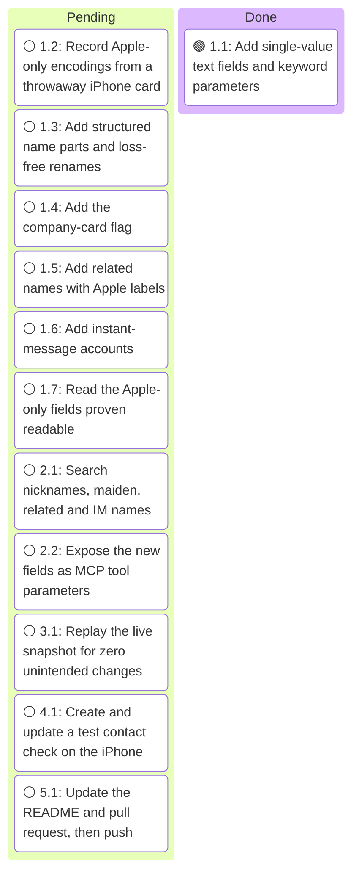
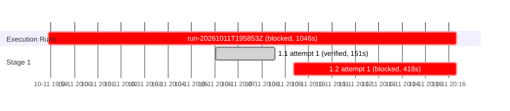

# Execution Ledger: Contact Fields Completion

<!-- spec-nav:start -->
**Spec navigation:** [State](00_state.md) · [Discovery](01_discovery.md) · [Requirements](02_requirements.md) · [Design](03_design.md) · [Tasks](04_tasks.md) · [Execution](05_execution.md)
<!-- spec-nav:end -->

## Active Wave

| Task | Stage | Mode | Branch / worktree | State |
|---:|---:|---|---|---|
| 1.2 | 1 | controller | `feature/birthday-social-profiles` / main checkout | dispatched |

| Task | Status | Commit / diff | Verification | Reviewer | Notes |
|---|---|---|---|---|---|
| 1.1 | verified | `056c35a` | 111 tests pass (9 new); ruff clean; snapshot no-op replay unchanged (0 contacts changed apart from 1 HTML note) | controller self-check; wave review pending | ORG edited in place |
| 1.2 | blocked | — | ringtone encoding recorded; whole-book ETag diff: 1 new card, 0 changed | — | iPhone Mirroring rejects scroll input; waiting for the user to add text tone, lunar birthday and verification code to the throwaway card |
| 1.3 | not_started | — | — | — | — |
| 1.4 | not_started | — | — | — | — |
| 1.5 | not_started | — | — | — | — |
| 1.6 | not_started | — | — | — | — |
| 1.7 | not_started | — | — | — | — |
| 2.1 | not_started | — | — | — | — |
| 2.2 | not_started | — | — | — | — |
| 3.1 | not_started | — | — | — | — |
| 4.1 | not_started | — | — | — | — |
| 5.1 | not_started | — | — | — | — |

## Baseline

| Revision | Command | Exit | Pre-existing failures |
|---|---|---:|---|
| `a55261963ddf40cf768c712bcd0cab05d05e3d89` | `.venv/bin/pytest -q` (102 tests) and `.venv/bin/ruff check src tests` | 0 | none |

Work happens directly on `feature/birthday-social-profiles`, the branch behind pull request sohampatwardhan/icloud-mcp#1, at the user's request to commit there. The tree was clean at the base commit, and no separate worktree is used.

## Preflight

- **Depth:** thorough. The work changes the public MCP tool contract and handles personal contact data.
- **Review fan-out:** 2 reviewers at `balanced` tier with `high` reasoning, and 2 repair rounds per defect.
- **Artifact digest** (SHA-256 of [01_discovery.md](01_discovery.md) through [04_tasks.md](04_tasks.md)): `3f9dd5193e2e2299bbdac46786bf339e61c8bbc51a71f9d73f5ef6ef583619af`.

- **Hardening result.** Two reviewers (gaps and code) returned 21 findings. Every certain fix that stays within the approved requirements was applied to the design and tasks:
  - write-backs equal to the read are no-ops for name and parts;
  - `N` and `ORG` are edited in place, and `ORG` components from index 2 on are kept;
  - validation runs before mutation and before any network request on create;
  - related names and instant messages use dedicated matching, keep `pref`, and reserve old group numbers;
  - the service is derived from the URI scheme when missing;
  - updates are refused when iCloud returns no ETag, and 412 errors are split between create and update;
  - the device check now covers `is_company` and `department`.
- **Uncertain findings** became verification steps in task 3.1: unescaped commas in text properties, IMPP without a service type, multi-component `ORG` and company cards with no organization.
- **Targeted re-review.** It rejected two edits, and both were reverted:
  - **Company-first display name.** This was an unrequested change to the read `name`. Reads keep the existing behaviour.
  - **Change-only `is_company` validation.** This would have deviated from R3.7. R3.7 is kept as written, because the snapshot has no company card without an organization, so R6.2 is unaffected.
- **Requirements** changed only in their navigation links. The Design and Tasks gates stay approved under delegated authority.
- **Hardened artifact digest:** `2fbe1a0f086d84dc04ceeb92ee0a2dbcea3004dfbc225dfc9b6ca7cd22f5ac59`.

## Execution Timing

### Task Board

### Run Intervals
| Run ID | Started UTC | Stopped UTC | Elapsed Seconds | Outcome |
|---|---|---|---:|---|
| run-20261011T195853Z | 2026-10-11T19:58:53Z | 2026-10-11T20:16:19Z | 1046 | blocked |

### Task Attempt Intervals
| Run ID | Stage/Wave | Task | Attempt | Started UTC | Stopped UTC | Elapsed Seconds | Outcome |
|---|---|---|---:|---|---|---:|---|
| run-20261011T195853Z | Stage 1 | 1.1 | 1 | 2026-10-11T20:06:02Z | 2026-10-11T20:08:33Z | 151 | verified |
| run-20261011T195853Z | Stage 1 | 1.2 | 1 | 2026-10-11T20:09:21Z | 2026-10-11T20:16:19Z | 418 | blocked |

## Checkpoints

- Checkpoint 4 (live write to the user's iCloud account): pending. Execution stops here for the user's go-ahead.

## Integration Decision

- Status: pending
- Base: `feature/birthday-social-profiles`
- Result: pending
- Post-integration verification: pending

### Execution Gantt

