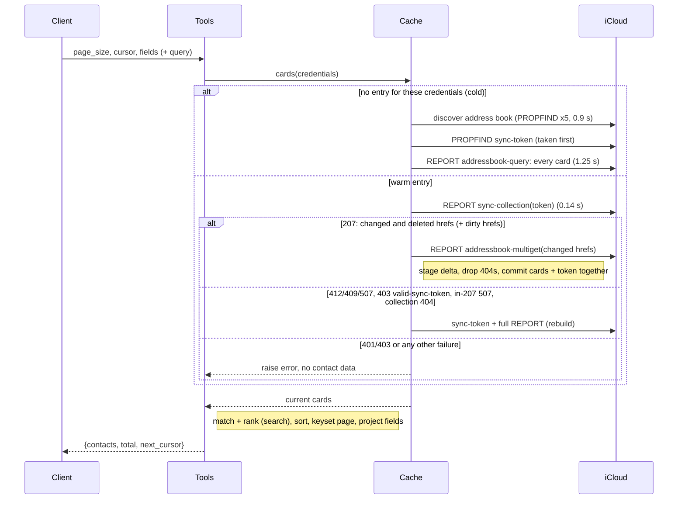

# Design: Contacts List Size and Search Speed

<!-- spec-nav:start -->
**Spec navigation:** [State](00_state.md) · [Discovery](01_discovery.md) · [Requirements](02_requirements.md) · [Design](03_design.md) · [Tasks](04_tasks.md) · [Execution](05_execution.md)
<!-- spec-nav:end -->

## Overview

The design realises discovery approach A: a checked in-memory cache, paged summaries and improved local search. The rejected alternatives were an unchecked time-based cache (stale data, credential risk), iCloud-side `text-match` search (it missed an existing card on the live account) and an on-disk cache (privacy).

A new module, `src/icloud_mcp/contacts_cache.py`, holds one entry per set of credentials: the address-book URL, a CardDAV sync token and the parsed cards. Every list or search call first asks iCloud for changes since that token, with the caller's credentials. It applies only changed and deleted cards, then sorts, filters, ranks, pages and projects the results in memory. Writes made through the server mark their card as dirty, so the next call re-fetches iCloud's copy even if the change report lags.

> [!IMPORTANT]
> Approval gate: approve this design before work begins on [04_tasks.md](04_tasks.md).

**Live CardDAV evidence** (2026-10-11, the user's iCloud account, 1,800 people):

| Request | Cost | Use in the design |
|---|---|---|
| Address-book discovery | 5 requests, 0.9 s | done once per cache entry |
| `PROPFIND` `sync-token` | under 0.2 s | taken just before every full download |
| `REPORT addressbook-query`, every card | 1.56 MB, 1.25 s | cold start and token rebuild only |
| `REPORT sync-collection` with the current token | 178 bytes, 0.14 s | the per-call change check |
| `REPORT sync-collection` with an invalid token | HTTP 412 with `valid-sync-token` | the trigger for a rebuild |
| `REPORT addressbook-multiget`, 3 cards | 4.6 KB, 0.17 s | fetches only changed cards |
| Parsing and conversion of every card | 0.19 s | done once per changed card, never per call |

## Architecture

| Component | Location | Responsibility |
|---|---|---|
| Contact_Cache | new `src/icloud_mcp/contacts_cache.py` | Per-credential entries, the change check, delta and full fetches, caps and idle expiry |
| Contact_List / Contact_Search | [`src/icloud_mcp/contacts.py`](../../src/icloud_mcp/contacts.py) | Sorting, matching and ranking, keyset paging, cursors, field projection |
| Contact_Writer hooks | [`src/icloud_mcp/contacts.py`](../../src/icloud_mcp/contacts.py) | Patch the cache after create, update and delete |
| Contact_Tools | [`src/icloud_mcp/server.py`](../../src/icloud_mcp/server.py) | New `contacts_list` / `contacts_search` parameters and output shape |
| Configuration | [`src/icloud_mcp/config.py`](../../src/icloud_mcp/config.py) | `CONTACTS_CACHE`, `CONTACTS_CACHE_MAX_ACCOUNTS`, `CONTACTS_CACHE_IDLE_SECONDS` |

`get_contact` keeps its direct GET (R5.1), and the write request flows are unchanged (R5.2).

## Components and Interfaces

### Contact_Cache (`contacts_cache.py`)

The module imports nothing from `contacts.py`; its collaborators are injected, so existing test patches on `contacts._fetch_all_vcards` and `contacts._default_addressbook_url` keep working, and there is no import cycle.

```python
class ContactCache:
    def __init__(self, max_accounts: int, idle_seconds: float, *,
                 build_card: Callable[[str, str | None, str], Any | None],
                 clock: Callable[[], float] = time.monotonic, sweep_interval: float | None = 60.0): ...
    def cards(self, session: requests.Session, credentials: tuple[str, str], *,
              discover: Callable[[requests.Session], str],
              fetch_all: Callable[[requests.Session, str], list[dict]]) -> list[Any]: ...
    def mark_dirty(self, credentials: tuple[str, str], url: str) -> None: ...
    def sweep(self) -> None: ...
    def clear(self) -> None: ...
```

`build_card(url, etag, vcard_text)` returns a `CachedCard` (defined in `contacts.py`), or `None` for an unparsable card. `discover` and `fetch_all` are the existing `_default_addressbook_url` and `_fetch_all_vcards`, passed at call time.

**Entries and keys:**
- An entry is keyed by `hmac_sha256(process_secret, email.lower() + "\0" + password)`, where `process_secret` is 32 random bytes per process. The key never reveals the password, two different credentials never share an entry (R4.8), and nothing is persisted.
- An entry holds:
  - `addressbook_url`;
  - `token`;
  - `cards: dict[canonical_url, CachedCard]`;
  - `dirty: set[canonical_url]`;
  - `last_used`;
  - its own lock.
- `canonical_url` lowercases the scheme and host and drops the default port (443 for https, 80 for http), so URLs built by the write path match the URLs in sync responses.

**Locking protocol** (FastMCP 4.1.0 runs synchronous tools in worker threads, so concurrent calls happen):
- **The map lock** guards `entries` (committed, in least-recently-used order) and `pending` (a cold load in progress, keyed like `entries`). It is held only for short bookkeeping and never across I/O:
  - lookup and LRU touch;
  - finding or creating a pending entry;
  - committing (moving a pending entry into `entries` and evicting to the cap);
  - removing a pending entry after a failure;
  - the expiry sweep;
  - `clear()`.
- **An entry lock** serialises one account's network work.
- **Lock order.** A thread may hold an entry lock and then take the map lock, but only for the commit or failure bookkeeping at the end of a cold load. A thread holding the map lock never blocks on an entry lock: eviction and expiry use a non-blocking `acquire(False)` and skip an entry that is busy.
- **One download per account.** Two cold calls with the same credentials find the same pending entry. The second waits on its lock, then sees the committed entry, so only one full download happens. A failed cold load removes its pending entry, so failed logins never leave entries behind or count toward the cap.

**`cards()`:**

1. **Lookup.** Sweep expired entries. Under the map lock, find the committed entry, or the pending one, creating a pending entry if neither exists; then release the map lock and take the entry's lock.
2. **Cold** (pending, or no token):
   1. `addressbook_url = discover(session)`.
   2. `PROPFIND` the collection's `DAV:sync-token`, taken before the download so a change in between is reported again by the next check.
   3. `fetch_all(session, url)`, then `build_card` each card.

   Only after all of this succeeds is the entry committed: inserted into the map, evicting the least recently used entry beyond `max_accounts` (R4.9). A failed cold load inserts nothing, so failed logins cannot push valid accounts out of the cache.
3. **Warm.** `REPORT sync-collection` with the stored token, `sync-level 1` and `DAV:getetag`. Parse each `d:response`:
   - **The collection itself** (its href path equals the address-book path): if its `d:status` is 507, the report is truncated; go to step 4. Otherwise ignore it.
   - **A card whose own `d:status` is 404 or 410:** deleted.
   - **A card with a 200 propstat** whose ETag differs from the cached one, or is not cached: needs a fetch. Every href other than the collection counts as a card, not only `.vcf` names.
   - **The new token is required.** A 207 without one raises.
4. **Rebuild** on HTTP 412, 409 or 507, a 403 whose body names `valid-sync-token`, an in-207 truncation, or a 404/410 on the collection itself (a stale address-book URL, which forces rediscovery). Discard the entry's state and run the cold path once (R4.5).
5. **Fetch** the hrefs to fetch, plus `entry.dirty`, with `addressbook-multiget` in chunks of 100, using href paths.
   - For each requested href: 200 with `address-data` → `build_card`. If it returns `None`, remove the card and log the url only. A 404 → remove.
   - Any other outcome, including an href missing from the response, raises (R4.6).
6. **Commit atomically.** The delta is applied to a staged copy of `cards`. Only when every chunk is complete do the staged cards, the new token and the cleared `dirty` set replace the entry's state. On any exception the entry is left exactly as it was (Property 9).
7. **Other errors.** Any other HTTP error (401, a 403 without `valid-sync-token`, 5xx) and any network error propagates unchanged, with no cards returned (R4.4, R4.6). The existing `_run` maps 401/403 to the authentication tool error.
8. **Return** `list(entry.cards.values())`, a snapshot copy.

**`mark_dirty(credentials, url)`** adds the canonical URL to the entry's `dirty` set, under the entry lock, when an entry exists. It is called after the server's own successful create, update or delete. The next `cards()` then multigets those hrefs even if iCloud's change report omits or lags the write: a deleted card returns 404 and is removed. The server never builds a cached card from its own serialized vCard, so the cache always holds iCloud's copy, and a late mark can only cause one extra fetch (R4.7).

**`sweep()`** removes entries idle for longer than `idle_seconds`, skipping any entry whose lock is held. It runs:
- on every `cards()` call;
- from a daemon thread every `sweep_interval` seconds, started lazily when the first entry is committed;

so idle data is discarded even if no further calls arrive (R4.10). Tests pass `sweep_interval=None` and an injected clock.

**Request details.** Requests reuse the live-verified shapes: `sync-collection` with `Depth: 1` (the form verified against iCloud) and multiget with href paths. Each call issues one debug log line naming the path taken (cold, warm or rebuild) and the number of changes, never contact values.

**Kill switch.** When `config.CONTACTS_CACHE` is false, `contacts.py` bypasses the cache and calls `fetch_all` plus `build_card` on every request (R4.11).

### Contact_List / Contact_Search (`contacts.py`)

```python
@dataclass
class CachedCard:
    url: str
    etag: str | None
    contact: dict[str, Any]      # _vcard_to_dict(...) output; never mutated after creation
    listed: bool                 # not a Contacts list (group): every person, per the requirements' definition
    sort_key: tuple[int, str]    # (0 if named else 1, fold(name)): nameless people sort last
    name_text: str               # folded name, nickname, maiden name, name parts, phonetic and pronunciation names
    other_text: str              # folded text of every other field searched today (R3.6)
    phone_digits: list[str]

CONTACT_FIELDS: frozenset[str]   # every key _vcard_to_dict can emit, plus "phone" and "email"
SUMMARY_FIELDS = ("id", "name", "organization", "phone", "email")   # phone/email: first value, "" if none
def _people(session, credentials) -> list[CachedCard]          # listed cards, via the cache or the kill-switch path
def list_contacts(page_size: int = 50, cursor: str | None = None, fields: list[str] | None = None) -> dict
def search_contacts(query: str, page_size: int = 50, cursor: str | None = None, fields: list[str] | None = None) -> dict
# both return {"contacts": [...], "total": int, "next_cursor": str | None}
```

- **Text folding.** `fold(text)` is `unicodedata.normalize("NFKD", text)` with combining marks removed, then `casefold()`, then `str.translate` for letters NFKD leaves intact: `ł→l`, `ø→o`, `đ→d`, `ħ→h`, `ð→d`, `þ→th`, `ı→i`, `æ→ae`, `œ→oe`. Query and text are folded the same way.
- **Listing.** Every person is listed, meaning every card that is not a Contacts list, per the requirements' definition. Cards without a name sort after named people. Listed cards are ordered by `(sort_key, url)` (R1.1).
- **Search** (R3.1–R3.6):
  1. Words are `fold(query).split()`, each with a leading `@` stripped; empty words are dropped. No words left raises the empty-query error (R3.7). `qnorm` is the words joined by single spaces.
  2. A word containing at least one digit also matches a phone whose digits contain the word's digits (R3.5). A word with no digits never matches through phones.
  3. Any word matches if it is a substring of `name_text` or `other_text`.
  4. A person matches when every word matches.
  5. **Ranking** (R3.3): rank 0 if `fold(name)` starts with `qnorm`, rank 1 if every word matches `name_text`, otherwise rank 2. Results are ordered by `(rank, sort_key, url)`.
- **Keyset paging** (R1.2–R1.7, R3.4).
  - A cursor is the URL-safe base64 encoding of JSON `{"v": 1, "q": <fingerprint>, "after": [rank, named_flag, sort_name, url]}`. The fingerprint is the first 16 hex characters of the SHA-256 of `"list"` or `"search:" + qnorm`. `page_size` and `fields` are deliberately not part of it, so a caller may change them between pages.
  - `_decode_cursor` turns every failure into the R1.8 error. That covers bad base64, non-JSON, the wrong shape or version, a wrong fingerprint, wrong types, and a rank outside 0–2 (or not 0 for a list).
  - A page holds the first `page_size` people whose key is greater than `after`. `next_cursor` is set only when more remain, and `total` counts every match.
  - Adding or removing contacts between pages cannot repeat a person. Editing a contact between pages, which changes its name or rank, can move that one person across the cursor.
- **Field projection** (R2.1–R2.4).
  - Without `fields`, or with `[]`, each entry is the summary.
  - With `["all"]`, it is the full `contact` dict, exactly what `contacts_get` returns.
  - Otherwise it is `id` plus each named field. A field the card does not have, such as `ringtone`, is omitted.
  - A name outside `CONTACT_FIELDS`, or `"all"` combined with other names, raises an error listing the valid names.
- **Validation.** `page_size` must be between 1 and 200 (R1.3), and the query must leave at least one word (R3.7).

### Contact_Writer hooks

`create_contact`, `update_contact` and `delete_contact` call `cache.mark_dirty(credentials, url)` after a successful request. A failed request marks nothing (R4.7, R5.2).

### Contact_Tools (`server.py`)

```python
contacts_list(page_size: int = 50 (1..200), cursor: str | None = None, fields: list[str] | None = None) -> dict
contacts_search(query: str, page_size: int = 50 (1..200), cursor: str | None = None, fields: list[str] | None = None) -> dict
```

- The parameter descriptions explain that summaries are the default, how to use the cursor, and that `fields=["all"]` returns full records.
- The previous `limit` parameter is removed; this is a breaking change, noted in the pull request.
- `page_size` bounds are declared with `Field(ge=1, le=200)`, so FastMCP rejects bad values before the call (R1.3).

### Configuration (`config.py`)

| Variable | Default | Meaning |
|---|---|---|
| `CONTACTS_CACHE` | `true` | `false` disables the cache (R4.11) |
| `CONTACTS_CACHE_MAX_ACCOUNTS` | `8` | entries held at once (R4.9) |
| `CONTACTS_CACHE_IDLE_SECONDS` | `1800` | idle lifetime of an entry (R4.10) |

- **Sizing.** The defaults are sized from about 1.6 MB of raw cards per account, about 10 MB once parsed, so the worst case is about 80 MB. An idle local (stdio) server holds a single entry.
- **Parsing.** Values are parsed by testable helpers, `_env_positive_int(name, default, environ=os.environ)` and `_env_positive_float(...)`, which reject zero and negative values.
- **Test isolation.** An autouse test fixture clears the module-level cache around every test.

## Data Models

`CachedCard` and the cache entry are defined under Contact_Cache above. An entry holds the address-book URL, the sync token, `{url: CachedCard}` and its last-used time.

**Response shape.** List and search return:

```json
{"contacts": [{"id": "https://…/card/….vcf", "name": "…", "organization": "…", "phone": "…", "email": "…"}],
 "total": 1799, "next_cursor": "eyJ2IjoxLC…"}
```

## Sequence / Flows

A read call, `contacts_list` or `contacts_search`:



The structured source of this diagram is [`diagrams/flows.json`](diagrams/flows.json).

A write call runs the existing GET and PUT (or DELETE) flow, then `mark_dirty`. The next read call multigets the dirty hrefs along with the change report.

## Correctness Properties

### Property 1: Complete, ordered, duplicate-free paging
Following `next_cursor` from the first page to the end returns every listed person exactly once, in name order with nameless people last, with a correct `total`. With adds or removes between pages, no person is returned twice, because each page starts strictly after the last key served. An edit that changes a person's name or rank between pages is a documented limitation.
**Validates: Requirements 1.1, 1.2, 1.4, 1.5, 1.6, 1.7, 1.9**

### Property 2: Bad paging input is rejected
A page size outside 1–200 is rejected by the tool schema. A cursor that does not decode, or whose fingerprint differs from the current query's, raises an error that says to start from the first page.
**Validates: Requirements 1.3, 1.8**

### Property 3: Field projection
Default entries are exactly the five summary keys. Named fields return `id` plus exactly those fields. `["all"]` returns the same dict as `contacts_get`. Unknown names raise an error listing the valid names.
**Validates: Requirements 2.1, 2.2, 2.3, 2.4**

### Property 4: Small default pages
On the user's snapshot, the largest default page of 50 summaries serializes to at most 16,000 bytes.
**Validates: Requirements 2.5**

### Property 5: Folded multi-word matching
A person matches a query exactly when every folded query word is a substring of their folded searchable text, or, for a word containing at least one digit, matches a phone by its digits. Folding covers diacritics and the stroke letters NFKD leaves intact. The searchable text covers every field searched before this feature.
**Validates: Requirements 3.1, 3.2, 3.5, 3.6**

### Property 6: Ranked, paged search results
Search results are ordered by rank (name-prefix match, then name-word match, then any other match), then by name, and are paged and projected exactly as list results are.
**Validates: Requirements 3.3, 3.4**

### Property 7: Empty queries are rejected
A query that is empty after trimming raises a validation error before any request is sent.
**Validates: Requirements 3.7**

### Property 8: Answers reflect iCloud's current state
Every list or search call runs the change check with the caller's credentials before answering. After any sequence of edits made elsewhere or through the server, and after any number of changes, which can span several multiget chunks, the cards served equal the set the server would download in full at that moment. A delta is committed only as a whole, together with its token.
**Validates: Requirements 4.2, 4.3, 4.7**

### Property 9: No data on failure
If the change check, or any multiget chunk, fails with an authentication or other error, or omits a requested card, the call raises and returns no contacts. The entry's cards, token and dirty set are unchanged, and a failed cold load inserts no entry.
**Validates: Requirements 4.4, 4.6**

### Property 10: Rejected tokens rebuild
After a 412, 409 or 507, a 403 naming `valid-sync-token`, an in-207 truncation (a 507 status on the collection's own entry) or a 404/410 on the collection, the entry is rebuilt with one rediscovery and full download, and the call answers from the rebuilt data.
**Validates: Requirements 4.5**

### Property 11: Isolation between credentials
Entries are keyed by an HMAC of email and password with a per-process secret, so a call can only read the entry created by the same credentials. That entry is still re-checked against iCloud with those credentials on every call.
**Validates: Requirements 4.8**

### Property 12: Bounded memory
The cache never holds more than `CONTACTS_CACHE_MAX_ACCOUNTS` committed entries. Failed cold loads never insert one. An entry idle for longer than `CONTACTS_CACHE_IDLE_SECONDS` is dropped, either by the next call's sweep or by the background sweeper within `sweep_interval`.
**Validates: Requirements 4.9, 4.10**

### Property 13: Kill switch
With `CONTACTS_CACHE=false`, every list or search call performs the full discovery and download, and the cache map stays empty.
**Validates: Requirements 4.11**

### Property 14: Warm calls are fast
On the user's account, each of 10 consecutive warm list and search calls with no changes completes in under 0.5 s, including the change-check request and a fresh HTTP session. If the per-call TLS handshake makes this fail, the entry keeps its own session for reuse under its lock.
**Validates: Requirements 4.1**

### Property 15: Everything else is unchanged
`contacts_get`, create, update and delete keep their request and response shapes. List and search issue only GET, PROPFIND and REPORT requests.
**Validates: Requirements 5.1, 5.2, 5.3**

## Error Handling / Edge Cases

- **Bad cursor** (R1.8). A cursor that is malformed, of the wrong shape or for a different query raises `ValueError("cursor is invalid or belongs to a different query; start again without a cursor")` from `_decode_cursor`, never a `TypeError`.
- **Empty query** (R3.7). A query that is empty after folding and `@`-stripping raises `ValueError("query must not be empty")`.
- **Unknown field** (R2.4). A field outside `CONTACT_FIELDS`, or `"all"` combined with other names, raises `ValueError` naming the valid fields.
- **Token rejection and truncation** (R4.5). These lead to a rebuild as described in `cards()` steps 3–4. A 207 without a new token raises rather than storing nothing.
- **Partial or failed delta** (R4.6). An href missing from a multiget response, a non-200/404 result, or a failed chunk raises before commit, and the next call replays the same token.
- **Unparsable changed card.** It is removed from the cache, with a debug log naming the url only.
- **Authentication and other errors** (R4.4, R4.6) propagate, and the existing `_run` mapping applies.
- **Concurrent calls** for the same credentials serialise on the entry lock. Two cold calls share one download, and calls for different credentials run in parallel.
- **Lists (groups)** stay in the cache but are excluded from list and search results, as they are today. Cards with no name, phone or email are now listed, sorted last, because the requirements define a person as any non-group contact.

## Testing Strategy

| Level | What | Criteria |
|---|---|---|
| Unit: paging and search (`_people` seam) | Full traversal exactly once, with nameless people last. Adds and removes between pages. Cursor robustness (bad base64, non-JSON, wrong shape, version or type, other query). `page_size`/`fields` changes mid-traversal. Projection: summary, named fields, absent field, `["all"]`, `"all"` mixed, unknown. Folding: José, Straße, Łukasz, Øyvind, Đorđe, İstanbul. Multi-word in any order. Digit words in several phone formats, and punctuation-only words ("smith - jones") not matching every phone. Ranking. `@` words. Empty query. | R1.x, R2.1–2.4, R3.x |
| Unit: cache (fake CardDAV in `tests/fake_carddav.py`) | Cold load (sync-token PROPFIND before the REPORT). Warm with no change (exactly one REPORT). Changed card. More than 100 changes across chunks. Deleted card. Unchanged-ETag entry (no multiget). Collection, group and non-`.vcf` hrefs. Unparsable changed card. 412, 409, a 403 naming `valid-sync-token`, HTTP 507 and in-207 507: one rebuild each. 404 on the collection: rediscovery. 401 and 500: raise with the entry unchanged. A cold 401 inserts no entry. An omitted href and a failing chunk 2: the entry is unchanged, and the next call converges. A 207 without a token raises. Different passwords stay isolated. Cap: 20 bad logins don't evict a good entry. Idle expiry (clock plus `sweep`). Two concurrent cold calls make one download, without deadlock. `mark_dirty` with a lagging change report. URL canonicalisation (an explicit port 443). Only GET, PROPFIND and REPORT are issued. | R4.2–4.10, R5.3 |
| Unit: config | `_env_positive_int`/`_float` defaults, overrides and rejection | R4.9–4.11 |
| MCP protocol | `contacts_list` / `contacts_search` schemas (`page_size` bounds, no `limit`), the response shape, and the unchanged shapes of the other tools | R1.3, R5.1, R5.2 |
| Live, read-only | 10 warm calls timed on the user's account, each under 0.5 s with raw timings recorded. The largest default page measured. Full traversal compared with every non-group card in a direct download, computed without `build_card`. Accent probes on real names. | R2.5, R4.1, R1.6 |
| Live freshness | A throwaway card edited on the iPhone: the next search shows the edit. After the user deletes the card, the next call no longer returns it. | R4.3 |

## Cross-Cutting Risk Gates

| Gate | Applies | Failure mode | Verification and decision |
|---|---|---|---|
| Authorization / isolation | yes | One caller's cached contacts are served to another | HMAC keying, a change check on every call with the caller's credentials, and a unit test with two sets of credentials |
| Privacy | yes | Contact data persists or leaks into logs | Memory only, idle expiry and caps; no cached values in logs; no disk storage |
| Freshness / data correctness | yes | Stale or missing contacts after an edit elsewhere | Change check on every call, rebuild on token rejection, and the live edit test |
| Performance | yes | Warm calls slower than 0.5 s, or memory growth | Live timing; caps; work per call proportional to the number of changes |
| Compatibility | yes | Clients relying on the list output or on `limit` | Breaking change accepted in discovery and noted in the pull request; `contacts_get` unchanged |
| Rollout / rollback | yes | A cache bug in production | `CONTACTS_CACHE=false` restores today's behaviour without a code change |
| Observability | low | Cache behaviour invisible when debugging | One debug-level log line per call naming the path taken (cold, warm, rebuild) and the number of changes, never contact values |
| Accessibility | not applicable | No user interface | — |

## Current Technology Evidence

Not applicable because the design depends on CardDAV and WebDAV protocol behaviour that was verified directly against the live iCloud service (results in the Overview table), and on Python's standard library. No new or changed library behaviour is used, and the FastMCP 4.1.0 parameter validation relied on here is the same as the earlier contact-fields-completion design.

## Dependency Security Evidence

No new or upgraded dependency is selected or required: the feature uses the already-installed `requests`, `vobject`, `defusedxml` and `fastmcp`, plus the Python standard library (`hmac`, `secrets`, `unicodedata`, `threading`).
