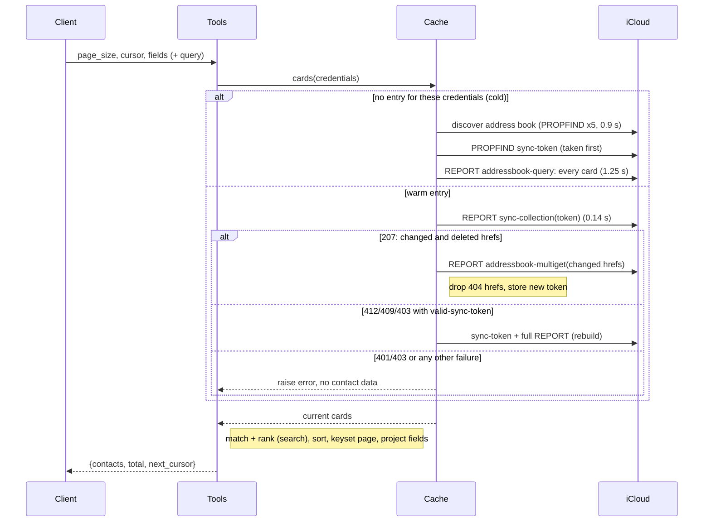

# Design: Contacts List Size and Search Speed

<!-- spec-nav:start -->
**Spec navigation:** [State](00_state.md) · [Discovery](01_discovery.md) · [Requirements](02_requirements.md) · [Design](03_design.md) · [Tasks](04_tasks.md)
<!-- spec-nav:end -->

## Overview

The design realises discovery approach A: a checked in-memory cache, paged summaries and improved local search. The rejected alternatives were an unchecked time-based cache (stale data, credential risk), iCloud-side `text-match` search (it missed an existing card on the live account) and an on-disk cache (privacy).

A new module, `src/icloud_mcp/contacts_cache.py`, holds one entry per set of credentials: the address-book URL, a CardDAV sync token and the parsed cards. Every list or search call first asks iCloud for changes since that token, with the caller's credentials. It applies only changed and deleted cards, then sorts, filters, ranks, pages and projects the results in memory. Writes made through the server patch the entry directly, and the next change check reconciles anything else.

> [!IMPORTANT]
> Approval gate: approve this design before work begins on [04_tasks.md](04_tasks.md).

**Live CardDAV evidence** (2026-10-11, the user's iCloud account, 1,800 people):

| Request | Cost | Use in the design |
|---|---|---|
| Address-book discovery | 5 requests, 0.9 s | done once per cache entry |
| `PROPFIND` `sync-token` | under 0.2 s | taken just before every full download |
| `REPORT addressbook-query`, every card | 1.56 MB, 1.25 s | cold start and token rebuild only |
| `REPORT sync-collection` with the current token | 178 bytes, 0.14 s | the per-call change check |
| `REPORT sync-collection` with an invalid token | HTTP 412 with `valid-sync-token` | the trigger for a rebuild |
| `REPORT addressbook-multiget`, 3 cards | 4.6 KB, 0.17 s | fetches only changed cards |
| Parsing and conversion of every card | 0.19 s | done once per changed card, never per call |

## Architecture

| Component | Location | Responsibility |
|---|---|---|
| Contact_Cache | new `src/icloud_mcp/contacts_cache.py` | Per-credential entries, the change check, delta and full fetches, caps and idle expiry |
| Contact_List / Contact_Search | [`src/icloud_mcp/contacts.py`](../../src/icloud_mcp/contacts.py) | Sorting, matching and ranking, keyset paging, cursors, field projection |
| Contact_Writer hooks | [`src/icloud_mcp/contacts.py`](../../src/icloud_mcp/contacts.py) | Patch the cache after create, update and delete |
| Contact_Tools | [`src/icloud_mcp/server.py`](../../src/icloud_mcp/server.py) | New `contacts_list` / `contacts_search` parameters and output shape |
| Configuration | [`src/icloud_mcp/config.py`](../../src/icloud_mcp/config.py) | `CONTACTS_CACHE`, `CONTACTS_CACHE_MAX_ACCOUNTS`, `CONTACTS_CACHE_IDLE_SECONDS` |

`get_contact` keeps its direct GET (R5.1), and the write request flows are unchanged (R5.2).

## Components and Interfaces

### Contact_Cache (`contacts_cache.py`)

```python
@dataclass
class CachedCard:
    url: str
    etag: str | None
    contact: dict[str, Any]      # _vcard_to_dict(...) output; never mutated after creation
    is_group: bool
    sort_name: str               # fold(contact["name"])
    name_text: str               # folded text of name, nickname, maiden name, name parts
    other_text: str              # folded text of every other searched field (R3.6)
    phone_digits: list[str]

class ContactCache:
    def __init__(self, max_accounts: int, idle_seconds: float, clock: Callable[[], float] = time.monotonic): ...
    def cards(self, session: requests.Session, credentials: tuple[str, str]) -> list[CachedCard]: ...
    def record_write(self, credentials: tuple[str, str], url: str, vcard_text: str, etag: str | None) -> None: ...
    def record_delete(self, credentials: tuple[str, str], url: str) -> None: ...
    def clear(self) -> None: ...
```

**Entry key.** An entry is keyed by `hmac_sha256(process_secret, email.lower() + "\0" + password)`. `process_secret` is 32 random bytes generated when the process starts. The key never reveals the password, two different credentials never share an entry (R4.8), and nothing is persisted. Entries live in an `OrderedDict` in least-recently-used order.

**`cards()`** under the entry's lock:

1. **Expire and cap.** Drop entries idle for more than `idle_seconds` (R4.10). If the map would exceed `max_accounts`, evict the least recently used entry (R4.9).
2. **Cold entry** (absent, or without a token):
   1. Discover the address-book URL (existing `_default_addressbook_url`).
   2. `PROPFIND` the collection's `DAV:sync-token`.
   3. Download every card with the full `addressbook-query` (existing `_fetch_all_vcards`).
   4. Build the cards and store the token.

   The token is read before the download, so a change landing between the two is reported again by the next check rather than lost.
3. **Warm entry:**
   1. `REPORT sync-collection` with the stored token and `sync-level 1`, asking for `DAV:getetag`.
   2. Each response whose status is 404, or 410, is a deleted card: remove it.
   3. Each 200 response with an ETag different from the cached one is a changed or new card. Its body is fetched with `addressbook-multiget` in chunks of 100 hrefs.
   4. Store the new token. Responses for the collection itself, and hrefs that are not `.vcf`, are ignored.
4. **Token rejected.** On HTTP 412 or 409, or a 403 whose body names `valid-sync-token`, or a 507 truncated response, discard the entry's cards and run the cold path once (R4.5).
5. **Any other failure.** Any other HTTP error, including 401 and a 403 without `valid-sync-token`, and any network error, propagates unchanged. The entry is left as it was, and no cards are returned (R4.4, R4.6). The existing `_run` maps 401/403 to the authentication tool error.
6. **Return** the entry's cards in a list; sorting happens in Contact_List.

**`record_write` / `record_delete`** patch the entry if one exists for those credentials: they replace the card built from the written vCard, or remove it. The next change check then reports the write with the server's ETag, and the card is re-fetched once. That keeps the server's own writes visible even if iCloud's change report lags (R4.7).

**Thread safety.** One `threading.Lock` guards the entry map and one guards each entry, because FastMCP may run synchronous tools in worker threads.

**Kill switch.** When `CONTACTS_CACHE` is false, `contacts.py` bypasses the cache and calls the existing full fetch on every request (R4.11).

### Contact_List / Contact_Search (`contacts.py`)

```python
SUMMARY_FIELDS = ("id", "name", "organization", "phone", "email")   # phone/email: first value, "" if none
def list_contacts(page_size: int = 50, cursor: str | None = None, fields: list[str] | None = None) -> dict
def search_contacts(query: str, page_size: int = 50, cursor: str | None = None, fields: list[str] | None = None) -> dict
# both return {"contacts": [...], "total": int, "next_cursor": str | None}
```

- **Text folding.** `fold(text)` is `unicodedata.normalize("NFKD", text)`, with combining marks removed, then `str.casefold()`.
- **Listing.** People only (`is_group` false), ordered by `(sort_name, url)` (R1.1).
- **Search** (R3.1–R3.6):
  1. Fold the query, split it on whitespace, and strip a leading `@` from each word.
  2. A word matches if it is a substring of `name_text` or `other_text`, or, when it contains digits, if its digits occur inside one of the `phone_digits`.
  3. As today, the query's full digit string also matches a phone on its own.
  4. A person matches when every word matches.
  5. **Ranking** (R3.3): rank 0 if `sort_name` starts with the folded query; rank 1 if every word matches `name_text`; otherwise rank 2. Results are ordered by `(rank, sort_name, url)`.
- **Keyset paging** (R1.2–R1.7, R3.4).
  - A cursor is the URL-safe base64 encoding of JSON `{"v": 1, "q": <fingerprint>, "after": [rank, sort_name, url]}`. The fingerprint is the first 16 hex characters of the SHA-256 of `"list"` or `"search:" + folded query`.
  - A page holds the first `page_size` people whose key is greater than `after`. `next_cursor` is set only when more remain. `total` counts every match.
  - Because a page starts after the last key served, adding or removing contacts between pages can never repeat a person.
- **Field projection** (R2.1–R2.4). Without `fields`, each entry is the summary. With `fields=["all"]`, it is the full `contact` dict, exactly what `contacts_get` returns. Otherwise it is `id` plus each named field. Valid names are the keys of a full contact plus `phone` and `email`.
- **Validation.** `page_size` must be between 1 and 200 (R1.3), the query must be non-empty after trimming (R3.7), and field names must be known (R2.4).

### Contact_Writer hooks

`create_contact` and `update_contact` call `cache.record_write(credentials, url, serialized_vcard, response.headers.get("ETag"))` after a successful PUT. `delete_contact` calls `cache.record_delete`. Each hook runs only after the request succeeded, so a failed write leaves the cache untouched.

### Contact_Tools (`server.py`)

```python
contacts_list(page_size: int = 50 (1..200), cursor: str | None = None, fields: list[str] | None = None) -> dict
contacts_search(query: str, page_size: int = 50 (1..200), cursor: str | None = None, fields: list[str] | None = None) -> dict
```

- The parameter descriptions explain that summaries are the default, how to use the cursor, and that `fields=["all"]` returns full records.
- The previous `limit` parameter is removed; this is a breaking change, noted in the pull request.
- `page_size` bounds are declared with `Field(ge=1, le=200)`, so FastMCP rejects bad values before the call (R1.3).

### Configuration (`config.py`)

| Variable | Default | Meaning |
|---|---|---|
| `CONTACTS_CACHE` | `true` | `false` disables the cache (R4.11) |
| `CONTACTS_CACHE_MAX_ACCOUNTS` | `8` | entries held at once (R4.9) |
| `CONTACTS_CACHE_IDLE_SECONDS` | `1800` | idle lifetime of an entry (R4.10) |

The defaults are sized from about 1.6 MB of raw cards per account, about 10 MB once parsed, so the worst case is about 80 MB. An idle local (stdio) server holds a single entry.

## Data Models

`CachedCard` and the cache entry are defined under Contact_Cache above. An entry holds the address-book URL, the sync token, `{url: CachedCard}` and its last-used time.

**Response shape.** List and search return:

```json
{"contacts": [{"id": "https://…/card/….vcf", "name": "…", "organization": "…", "phone": "…", "email": "…"}],
 "total": 1799, "next_cursor": "eyJ2IjoxLC…"}
```

## Sequence / Flows

A read call, `contacts_list` or `contacts_search`:



The structured source of this diagram is [`diagrams/flows.json`](diagrams/flows.json).

A write call runs the existing GET and PUT (or DELETE) flow, then `record_write` (or `record_delete`).

## Correctness Properties

### Property 1: Complete, ordered, duplicate-free paging
Following `next_cursor` from the first page to the end returns every person exactly once, in name order, with a correct `total`. With adds or removes between pages, no person is returned twice, because each page starts strictly after the last key served.
**Validates: Requirements 1.1, 1.2, 1.4, 1.5, 1.6, 1.7, 1.9**

### Property 2: Bad paging input is rejected
A page size outside 1–200 is rejected by the tool schema. A cursor that does not decode, or whose fingerprint differs from the current query's, raises an error that says to start from the first page.
**Validates: Requirements 1.3, 1.8**

### Property 3: Field projection
Default entries are exactly the five summary keys. Named fields return `id` plus exactly those fields. `["all"]` returns the same dict as `contacts_get`. Unknown names raise an error listing the valid names.
**Validates: Requirements 2.1, 2.2, 2.3, 2.4**

### Property 4: Small default pages
On the user's snapshot, the largest default page of 50 summaries serializes to at most 16,000 bytes.
**Validates: Requirements 2.5**

### Property 5: Folded multi-word matching
A person matches a query exactly when every folded query word is a substring of their folded searchable text, or matches a phone by its digits. The searchable text covers every field searched before this feature.
**Validates: Requirements 3.1, 3.2, 3.5, 3.6**

### Property 6: Ranked, paged search results
Search results are ordered by rank (name-prefix match, then name-word match, then any other match), then by name, and are paged and projected exactly as list results are.
**Validates: Requirements 3.3, 3.4**

### Property 7: Empty queries are rejected
A query that is empty after trimming raises a validation error before any request is sent.
**Validates: Requirements 3.7**

### Property 8: Answers reflect iCloud's current state
Every list or search call runs the change check with the caller's credentials before answering. After any sequence of edits made elsewhere or through the server, the cards served equal the set the server would download in full at that moment.
**Validates: Requirements 4.2, 4.3, 4.7**

### Property 9: No data on failure
If the change check, or the delta fetch, fails with an authentication or other error, the call raises and returns no contacts, and the entry's stored state is unchanged.
**Validates: Requirements 4.4, 4.6**

### Property 10: Rejected tokens rebuild
After a 412, 409, a 403 naming `valid-sync-token`, or a 507 from `sync-collection`, the entry is rebuilt with one full download, and the call answers from the rebuilt data.
**Validates: Requirements 4.5**

### Property 11: Isolation between credentials
Entries are keyed by an HMAC of email and password with a per-process secret, so a call can only read the entry created by the same credentials. That entry is still re-checked against iCloud with those credentials on every call.
**Validates: Requirements 4.8**

### Property 12: Bounded memory
The cache never holds more than `CONTACTS_CACHE_MAX_ACCOUNTS` entries, and an entry idle for longer than `CONTACTS_CACHE_IDLE_SECONDS` is dropped before the next lookup.
**Validates: Requirements 4.9, 4.10**

### Property 13: Kill switch
With `CONTACTS_CACHE=false`, every list or search call performs the full discovery and download, and the cache map stays empty.
**Validates: Requirements 4.11**

### Property 14: Warm calls are fast
On the user's account, a warm list or search call with no changes completes in under 0.5 s, measured over 10 calls, including the change-check request.
**Validates: Requirements 4.1**

### Property 15: Everything else is unchanged
`contacts_get`, create, update and delete keep their request and response shapes. List and search issue only GET, PROPFIND and REPORT requests.
**Validates: Requirements 5.1, 5.2, 5.3**

## Error Handling / Edge Cases

- **Bad cursor or a different query** (R1.8): the call raises `ValueError("cursor is invalid or belongs to a different query; start again without a cursor")`.
- **Empty query** (R3.7): the call raises `ValueError("query must not be empty")`.
- **Unknown field** (R2.4): the call raises `ValueError` naming the valid fields.
- **Token rejection** (R4.5) is detected by status code, or by `valid-sync-token` in the error body for a 403, as above.
- **Authentication and other errors** (R4.4, R4.6) propagate, and the existing `_run` mapping applies.
- **Partial multiget.** If a multiget response omits a requested href, the card is treated as deleted on the next check. A missing href on a 200 sync entry triggers a re-fetch on the next check, because the token is only advanced after every multiget chunk succeeds.
- **Concurrent calls** for the same credentials serialise on the entry lock. Calls for different credentials run in parallel.
- **Lists (groups)** stay in the cache but are excluded from list and search results, as they are today.

## Testing Strategy

| Level | What | Criteria |
|---|---|---|
| Unit: paging and search | Seeded card sets: full traversal exactly once; adds and removes between pages; bad cursor; bounds; projection; folding ("jose" vs "José"); multi-word; digits; ranking; empty query | R1.x, R2.1–2.4, R3.x |
| Unit: cache with a fake CardDAV session | cold load; warm call with no change (one REPORT); a changed card (multiget); a deleted card (404); a 412 rebuild; 401 and 500 (raise, entry unchanged); isolation (different password, no shared entry); caps and idle expiry with an injected clock; kill switch; write hooks | R4.2–4.11, R5.3 |
| MCP protocol tests | `contacts_list` / `contacts_search` schemas (`page_size` bounds, no `limit`), the response shape, and the unchanged shapes of the other tools | R1.3, R5.1, R5.2 |
| Live, read-only | 10 warm calls timed on the user's account; largest default page measured on a snapshot; full traversal compared with a direct download | R2.5, R4.1, R1.6 |
| Live freshness | A throwaway card edited on the iPhone, through iPhone Mirroring or by the user: the next search shows the edit. After the user deletes the card, the next call no longer returns it. | R4.3 |

## Cross-Cutting Risk Gates

| Gate | Applies | Failure mode | Verification and decision |
|---|---|---|---|
| Authorization / isolation | yes | One caller's cached contacts are served to another | HMAC keying, a change check on every call with the caller's credentials, and a unit test with two sets of credentials |
| Privacy | yes | Contact data persists or leaks into logs | Memory only, idle expiry and caps; no cached values in logs; no disk storage |
| Freshness / data correctness | yes | Stale or missing contacts after an edit elsewhere | Change check on every call, rebuild on token rejection, and the live edit test |
| Performance | yes | Warm calls slower than 0.5 s, or memory growth | Live timing; caps; work per call proportional to the number of changes |
| Compatibility | yes | Clients relying on the list output or on `limit` | Breaking change accepted in discovery and noted in the pull request; `contacts_get` unchanged |
| Rollout / rollback | yes | A cache bug in production | `CONTACTS_CACHE=false` restores today's behaviour without a code change |
| Observability | low | Cache behaviour invisible when debugging | One debug-level log line per call naming the path taken (cold, warm, rebuild) and the number of changes, never contact values |
| Accessibility | not applicable | No user interface | — |

## Current Technology Evidence

Not applicable because the design depends on CardDAV and WebDAV protocol behaviour that was verified directly against the live iCloud service (results in the Overview table), and on Python's standard library. No new or changed library behaviour is used, and the FastMCP 4.1.0 parameter validation relied on here is the same as the earlier contact-fields-completion design.

## Dependency Security Evidence

No new or upgraded dependency is selected or required: the feature uses the already-installed `requests`, `vobject`, `defusedxml` and `fastmcp`, plus the Python standard library (`hmac`, `secrets`, `unicodedata`, `threading`).
