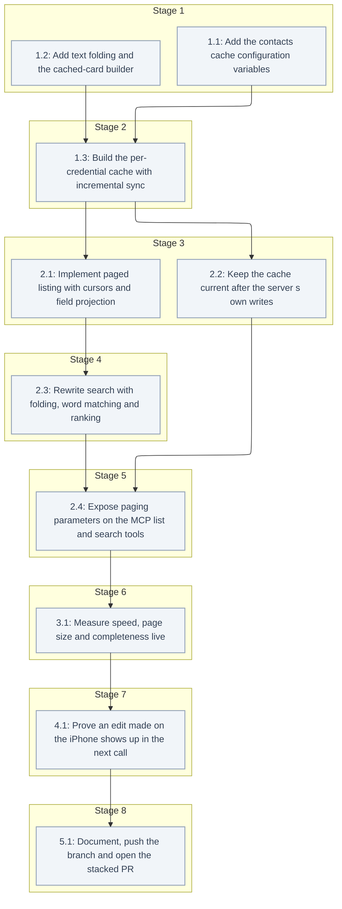

# Tasks: Contacts List Size and Search Speed

<!-- spec-nav:start -->
**Spec navigation:** [State](00_state.md) · [Discovery](01_discovery.md) · [Requirements](02_requirements.md) · [Design](03_design.md) · [Tasks](04_tasks.md)
<!-- spec-nav:end -->

## Stage and Dependency Overview

> [!WARNING]
> Execute dependency stages in order; every task runs sequentially. Stop at the checkpoint before the live freshness test, which edits a throwaway card in the user's iCloud account and needs the user to delete it afterwards. No task writes to a real contact.

## Checklist

- [ ] 1. Cache foundation
  - [ ] 1.1 Add the contacts cache configuration variables
    - Add `CONTACTS_CACHE: bool` (default `True`, read with `_env_bool`), `CONTACTS_CACHE_MAX_ACCOUNTS: int` (default `8`) and `CONTACTS_CACHE_IDLE_SECONDS: float` (default `1800`) to `Config`.
    - Reject non-positive numbers with a `ValueError` that names the variable.
    - **Files:** [`src/icloud_mcp/config.py`](../../src/icloud_mcp/config.py), `tests/test_contacts_cache.py`
    - **Dependency resolution:** none
    - **Dependency delivery:** none
    - **Depends on:** none
    - **Stage:** 1
    - **Interfaces:** Consumes: the design's Configuration table; Produces: `config.CONTACTS_CACHE`, `config.CONTACTS_CACHE_MAX_ACCOUNTS` and `config.CONTACTS_CACHE_IDLE_SECONDS`
    - **Documentation:** a comment block in `Config` stating each variable's meaning and why the defaults are what they are (memory per account)
    - **Verification:** `.venv/bin/pytest -q` passes with tests for the defaults, overrides and rejection of `0` and negative values; `.venv/bin/ruff check src tests` is clean; the comments are reviewed
    - **Estimated effort:** 15–25 minutes
    - **Risk:** low
    - **Task category:** quick_lookup
    - **Delegation:** sequential subagent
    - _Requirements: 4.9, 4.10, 4.11_
  - [ ] 1.2 Add text folding and the cached-card builder
    - Add `fold(text: str) -> str`: NFKD normalisation, combining marks removed, then `casefold()`.
    - Add the `CachedCard` dataclass with the design's exact fields, and `build_card(url: str, etag: str | None, vcard_text: str) -> CachedCard | None`.
      - It parses the vCard, runs `_vcard_to_dict` and sets `is_group`.
      - It fills `sort_name`, `name_text` (name, nickname, maiden name, name parts, phonetic and pronunciation names) and `other_text` (organization, department, notes, emails, formatted addresses, related names, instant-message usernames, social usernames and URLs), and `phone_digits`.
      - It returns `None` for an unparsable card.
    - **Files:** [`src/icloud_mcp/contacts.py`](../../src/icloud_mcp/contacts.py), [`tests/test_contacts.py`](../../tests/test_contacts.py)
    - **Dependency resolution:** none
    - **Dependency delivery:** none
    - **Depends on:** none
    - **Stage:** 1
    - **Interfaces:** Consumes: `_vcard_to_dict`, `_is_group`; Produces: `fold`, `CachedCard`, `build_card(url, etag, vcard_text) -> CachedCard | None`
    - **Documentation:** docstrings for `fold` (why NFKD plus casefold) and `build_card` (which fields feed `name_text` and `other_text`, and why ranking needs them separate)
    - **Verification:** `.venv/bin/pytest -q` passes with tests for:
      - `fold("José García") == "jose garcia"`, and `fold("Straße")` folding `ß`;
      - every field searched today appearing in `name_text` or `other_text`;
      - groups flagged as groups;
      - unparsable cards returning `None`.
      Also: `ruff` is clean, and the docstrings are reviewed.
    - **Estimated effort:** 30–45 minutes
    - **Risk:** low
    - **Task category:** code_analysis
    - **Delegation:** sequential subagent
    - _Requirements: 3.1, 3.6_
  - [ ] 1.3 Build the per-credential cache with incremental sync
    - Create `src/icloud_mcp/contacts_cache.py` with `ContactCache(max_accounts, idle_seconds, build_card, clock=time.monotonic)` and its methods: `cards(session, credentials)`, `record_write(credentials, url, vcard_text, etag)`, `record_delete(credentials, url)` and `clear()`.
    - Implement the design's flow:
      - the HMAC entry key with a per-process secret;
      - least-recently-used ordering, the cap and idle expiry;
      - the cold path: discovery, then `PROPFIND sync-token`, then the full `addressbook-query`;
      - the warm path: `sync-collection`, then `addressbook-multiget` in chunks of 100, dropping 404/410 hrefs;
      - a rebuild on 412, 409, 507 or a 403 naming `valid-sync-token`;
      - every other error propagating with the entry unchanged;
      - one lock for the map and one per entry;
      - one debug log line per call that names the path taken, never contact values.
    - Build the tests on a fake CardDAV session that parses the REPORT and PROPFIND bodies and serves a mutable card store with sync tokens.
    - **Files:** `src/icloud_mcp/contacts_cache.py`, `tests/test_contacts_cache.py`
    - **Dependency resolution:** none
    - **Dependency delivery:** none
    - **Depends on:** 1.1, 1.2
    - **Stage:** 2
    - **Interfaces:** Consumes: `build_card` and `CachedCard` from task 1.2, the config defaults from task 1.1, and the existing `_default_addressbook_url` and `_fetch_all_vcards`; Produces: the `ContactCache` class with the design's method signatures, raising `requests.HTTPError` unchanged on failures
    - **Documentation:** a module docstring explaining the change-checked design, the freshness guarantee and the isolation key; method docstrings stating their error contracts
    - **Verification:** `.venv/bin/pytest -q` passes with fake-server tests for:
      - a cold load;
      - a warm call with no change, issuing exactly one REPORT;
      - a changed card fetched by multiget;
      - a deleted card removed;
      - a 412 rebuild;
      - 401 and 500 raising with no cards and the entry unchanged;
      - a different password never reading another entry;
      - the cap and idle expiry with an injected clock;
      - `record_write` and `record_delete` visible on the next call;
      - only GET, PROPFIND and REPORT being issued.
      Also: `ruff` is clean, and the docstrings are reviewed.
    - **Estimated effort:** 90–150 minutes
    - **Risk:** high; incorrect delta handling would serve stale data. The cache can be disabled with `CONTACTS_CACHE=false`.
    - **Task category:** heavy_reasoning
    - **Delegation:** sequential subagent
    - _Requirements: 4.2, 4.3, 4.4, 4.5, 4.6, 4.8, 4.9, 4.10, 5.3_

- [ ] 2. Paged list, search and tool surface
  - [ ] 2.1 Implement paged listing with cursors and field projection
    - Replace `list_contacts` with `list_contacts(page_size=50, cursor=None, fields=None) -> {"contacts", "total", "next_cursor"}`.
      - It is backed by a module-level `ContactCache` built from config.
      - With `CONTACTS_CACHE=false`, it uses a full fetch through the same builder.
    - Implement the design's cursor format, `(rank, sort_name, url)` keyset paging, the summary fields, `fields` projection with `["all"]`, and the validation errors for bad cursors and unknown fields.
    - **Files:** [`src/icloud_mcp/contacts.py`](../../src/icloud_mcp/contacts.py), [`tests/test_contacts.py`](../../tests/test_contacts.py)
    - **Dependency resolution:** none
    - **Dependency delivery:** none
    - **Depends on:** 1.3
    - **Stage:** 3
    - **Interfaces:** Consumes: `ContactCache.cards()` and `CachedCard` from tasks 1.2 and 1.3, and the config from task 1.1; Produces: `list_contacts(page_size: int = 50, cursor: str | None = None, fields: list[str] | None = None) -> dict`, plus the shared helpers `_page(results, page_size, cursor, fingerprint, fields)` and `_project(card, fields)` that search reuses
    - **Documentation:** docstrings stating the response shape, the cursor contract (opaque, tied to its query) and why keyset paging never repeats a person
    - **Verification:** `.venv/bin/pytest -q` passes with tests for:
      - a 120-person traversal returning everyone exactly once in folded name order, with a correct `total` and no cursor on the last page;
      - adds and removes between pages producing no duplicates;
      - a malformed cursor, and a search cursor reused for the list, raising the restart error;
      - default summaries, named fields, `["all"]` equal to `_vcard_to_dict`, and an unknown field raising;
      - the kill switch making a full fetch on every call.
      Also: `ruff` is clean, and the docstrings are reviewed.
    - **Estimated effort:** 60–90 minutes
    - **Risk:** medium; this breaks the `contacts_list` output shape (accepted in discovery)
    - **Task category:** code_analysis
    - **Delegation:** sequential subagent
    - _Requirements: 1.1, 1.2, 1.4, 1.5, 1.6, 1.7, 1.8, 1.9, 2.1, 2.2, 2.3, 2.4, 4.11_
  - [ ] 2.2 Keep the cache current after the server's own writes
    - After a successful PUT in `create_contact` / `update_contact`, call `cache.record_write(credentials, url, serialized_vcard, response ETag)`.
    - After a successful DELETE in `delete_contact`, call `cache.record_delete(credentials, url)`.
    - Failed requests leave the cache untouched.
    - **Files:** [`src/icloud_mcp/contacts.py`](../../src/icloud_mcp/contacts.py), [`tests/test_contacts.py`](../../tests/test_contacts.py)
    - **Dependency resolution:** none
    - **Dependency delivery:** none
    - **Depends on:** 1.3
    - **Stage:** 3
    - **Interfaces:** Consumes: `ContactCache.record_write` / `record_delete` from task 1.3; Produces: create, update and delete keeping their current signatures and return values while updating the cache
    - **Documentation:** a one-line comment at each hook explaining why the server patches the cache rather than waiting for the next change report
    - **Verification:** `.venv/bin/pytest -q` passes with tests showing that a create, an update and a delete through the fake server appear in the next `list_contacts` even when the fake change report omits them, and that a failed PUT leaves the cache unchanged; `ruff` is clean
    - **Estimated effort:** 20–40 minutes
    - **Risk:** low
    - **Task category:** code_analysis
    - **Delegation:** sequential subagent
    - _Requirements: 4.7, 5.2_
  - [ ] 2.3 Rewrite search with folding, word matching and ranking
    - Replace `search_contacts` with `search_contacts(query, page_size=50, cursor=None, fields=None)`, implementing the design's matching:
      - folded words, all required, with a leading `@` stripped;
      - digit matching against `phone_digits`, plus the full-query digit rule;
      - rank 0, 1 or 2;
      - an empty query raising.
    - Page and project the results with the helpers from task 2.1, using the fingerprint `"search:" + folded query`.
    - **Files:** [`src/icloud_mcp/contacts.py`](../../src/icloud_mcp/contacts.py), [`tests/test_contacts.py`](../../tests/test_contacts.py)
    - **Dependency resolution:** none
    - **Dependency delivery:** none
    - **Depends on:** 2.1
    - **Stage:** 4
    - **Interfaces:** Consumes: `_page`, `_project`, `fold` and `ContactCache.cards()`; Produces: `search_contacts(query: str, page_size: int = 50, cursor: str | None = None, fields: list[str] | None = None) -> dict`
    - **Documentation:** a docstring listing the searched fields, the matching rules and the ranking
    - **Verification:** `.venv/bin/pytest -q` passes with tests for:
      - "jose garcia" finding "José García";
      - "garcia jose" finding the same contact;
      - "jose" ranking a name match above an organization-only match;
      - phone digits in several formats;
      - `@username`;
      - an empty query raising;
      - a search cursor working and being rejected for a different query;
      - the existing search tests, updated to the new output shape.
      Also: `ruff` is clean, and the docstrings are reviewed.
    - **Estimated effort:** 45–75 minutes
    - **Risk:** medium; this breaks the `contacts_search` output shape (accepted in discovery)
    - **Task category:** code_analysis
    - **Delegation:** sequential subagent
    - _Requirements: 3.1, 3.2, 3.3, 3.4, 3.5, 3.6, 3.7_
  - [ ] 2.4 Expose paging parameters on the MCP list and search tools
    - Change `contacts_list` to `(page_size: Annotated[int, Field(ge=1, le=200)] = 50, cursor: str | None = None, fields: list[str] | None = None) -> dict` and `contacts_search` to `(query, page_size, cursor, fields) -> dict`, removing `limit`.
    - Write the descriptions as specified in the design.
    - Add MCP protocol tests:
      - schema bounds, and the absence of `limit`;
      - the response shape through the protocol;
      - an out-of-range `page_size` being rejected;
      - unchanged schemas for `contacts_get`, `contacts_create`, `contacts_update` and `contacts_delete`.
    - **Files:** [`src/icloud_mcp/server.py`](../../src/icloud_mcp/server.py), [`tests/test_server.py`](../../tests/test_server.py)
    - **Dependency resolution:** none
    - **Dependency delivery:** none
    - **Depends on:** 2.2, 2.3
    - **Stage:** 5
    - **Interfaces:** Consumes: `list_contacts` / `search_contacts` from tasks 2.1 and 2.3; Produces: the MCP tool schemas and the `{contacts, total, next_cursor}` structured output
    - **Documentation:** tool docstrings and parameter descriptions explaining the summary default, how to use the cursor and `fields=["all"]`
    - **Verification:** `.venv/bin/pytest -q` passes, including the new protocol tests; `ruff` is clean; the descriptions are reviewed
    - **Estimated effort:** 30–45 minutes
    - **Risk:** low
    - **Task category:** code_analysis
    - **Delegation:** sequential subagent
    - _Requirements: 1.3, 5.1, 5.2_

- [ ] 3. Live read-only verification
  - [ ] 3.1 Measure speed, page size and completeness live
    - Write a read-only harness (writes blocked and self-checked) that, through the real code:
      - times 1 cold and 10 warm `list_contacts` and `search_contacts` calls;
      - measures the largest default page in bytes over a full traversal;
      - compares the traversed ids with the people in a direct full download;
      - checks that "jose"-style accent-folded searches find people whose names carry accents in the live data.
    - Record aggregate results only.
    - **Files:** `.specs/contacts-list-search-scale/execution/live_check.py`, `.specs/contacts-list-search-scale/execution/live-results.md`
    - **Dependency resolution:** none
    - **Dependency delivery:** none
    - **Depends on:** 2.4
    - **Stage:** 6
    - **Interfaces:** Consumes: CardDAV read access through the project's local credentials file, plus `list_contacts` and `search_contacts`; Produces: `live-results.md` with the cold and warm timings (median and maximum), the largest page in bytes, the traversal comparison and the accent-search results as counts
    - **Documentation:** a module docstring for the harness stating that it is read-only and prints aggregates only
    - **Verification:**
      - warm median and maximum both under 0.5 s;
      - largest default page at most 16,000 bytes;
      - the traversal equals the direct download, with every person exactly once;
      - every accent-folded probe finds its target.
    - **Estimated effort:** 30–60 minutes
    - **Risk:** low; read-only
    - **Task category:** review
    - **Delegation:** controller
    - _Requirements: 1.6, 2.5, 4.1_

- [ ] 4. Checkpoint — live freshness test on a throwaway card
  - [ ] 4.1 Prove an edit made on the iPhone shows up in the next call
    - With the user's go-ahead:
      1. Warm the cache.
      2. Edit an existing throwaway card ("ZZ MCP Fields Test") on the iPhone through iPhone Mirroring or by the user, for example by adding a nickname or changing the job title.
      3. Run `contacts_search` through the real MCP server and confirm the new value appears without a restart.
      4. After the user deletes the throwaway cards, confirm the next `contacts_list` no longer returns them.
    - Whole-book ETag comparisons show that only the throwaway card changed.
    - **Files:** `.specs/contacts-list-search-scale/execution/freshness-check.md`
    - **Dependency resolution:** none
    - **Dependency delivery:** none
    - **Depends on:** 3.1
    - **Stage:** 7
    - **Interfaces:** Consumes: the MCP server from task 2.4, iPhone Mirroring and the user's go-ahead; Produces: `freshness-check.md` recording the before and after values, the cache path taken (warm delta) and the deletion result
    - **Documentation:** no public surface
    - **Verification:**
      - the edited value is returned by the first call after the edit;
      - the deleted cards are absent from the first call after the deletion;
      - the ETag comparisons show no other card changed.
    - **Estimated effort:** 20–45 minutes
    - **Risk:** medium; it edits a throwaway card in the user's account. No real contact is touched, and the user does the deletion.
    - **Task category:** review
    - **Delegation:** controller
    - _Requirements: 4.3_

- [ ] 5. Delivery
  - [ ] 5.1 Document, push the branch and open the stacked PR
    - Update [`README.md`](../../README.md) (the list and search behaviour, and the cache variables) and [`.env.example`](../../.env.example) (the three cache variables, commented out).
    - Push `feature/contacts-list-search-scale` and open a pull request against `feature/birthday-social-profiles`, describing the breaking output change and the verification.
    - **Files:** [`README.md`](../../README.md), [`.env.example`](../../.env.example)
    - **Dependency resolution:** none
    - **Dependency delivery:** none
    - **Depends on:** 4.1
    - **Stage:** 8
    - **Interfaces:** Consumes: `live-results.md` and `freshness-check.md`; Produces: updated docs and a pull request URL
    - **Documentation:** the README and [`.env.example`](../../.env.example) are updated
    - **Verification:** `.venv/bin/pytest -q` and `ruff` pass on the pushed head; the pull request exists with the correct base and description
    - **Estimated effort:** 20–30 minutes
    - **Risk:** low
    - **Task category:** quick_lookup
    - **Delegation:** controller
    - _Requirements: 4.9, 4.10, 4.11_

## Delivery Schedule

| Stage | Task | Estimate | Depends on | Critical path |
|---:|---|---|---|---|
| 1 | 1.1 | 15–25 min | none | no |
| 1 | 1.2 | 30–45 min | none | yes |
| 2 | 1.3 | 90–150 min | 1.1, 1.2 | yes |
| 3 | 2.1 | 60–90 min | 1.3 | yes |
| 3 | 2.2 | 20–40 min | 1.3 | no |
| 4 | 2.3 | 45–75 min | 2.1 | yes |
| 5 | 2.4 | 30–45 min | 2.2, 2.3 | yes |
| 6 | 3.1 | 30–60 min | 2.4 | yes |
| 7 | 4.1 | 20–45 min | 3.1 | yes |
| 8 | 5.1 | 20–30 min | 4.1 | yes |

The total sequential effort is about 6–10 hours.
