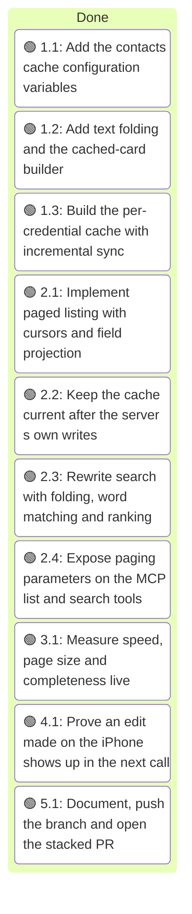
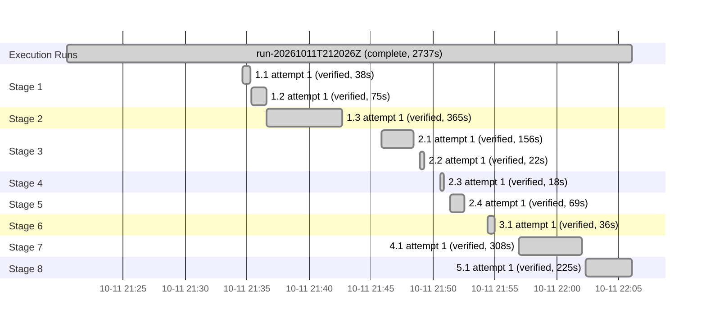

# Execution Ledger: Contacts List Size and Search Speed

<!-- spec-nav:start -->
**Spec navigation:** [State](00_state.md) · [Discovery](01_discovery.md) · [Requirements](02_requirements.md) · [Design](03_design.md) · [Tasks](04_tasks.md) · [Execution](05_execution.md)
<!-- spec-nav:end -->

## Active Wave

| Task | Stage | Mode | Branch / worktree | State |
|---:|---:|---|---|---|
| — | — | — | `feature/contacts-list-search-scale` / main checkout | all tasks verified |

| Task | Status | Commit / diff | Verification | Reviewer | Notes |
|---|---|---|---|---|---|
| 1.1 | verified | `baed4e2` | 173 tests pass (5 new); ruff clean | controller self-check; wave review pending | — |
| 1.2 | verified | `f5a8553` | 184 tests pass (11 new); ruff clean; all 1,814 live cards build in 0.20 s, 0 unparsable | controller self-check; wave review pending | — |
| 1.3 | verified | `bf8c1eb` | 213 tests pass (29 new, on a fake CardDAV server); ruff clean | controller self-check; wave review pending | ETags are trimmed and card URLs normalise percent-encoding, so `%40` and `@` name one card |
| 2.1 | verified | `bd95049` | 238 tests pass (25 new: 120-person traversal, adds/removes between pages, 13 bad cursors, projection, page-size bounds, kill switch); ruff clean | controller self-check; wave review pending | `_page` takes the decoded cursor position, so page size, fields and cursor are all validated before any request. Follow-up `2055163` keeps card ids identical on warm and cold loads |
| 2.2 | verified | `e2b21a0` | 240 tests pass (2 new); the hook test fails with the hooks removed; ruff clean | controller self-check; wave review pending | The fake server's write handlers and lagging-report switch were already added in task 1.3 |
| 2.3 | verified | `e441e12` | 258 tests pass (18 new: accents, word order, six stroke/dotted letters, ranking, five phone formats, punctuation-only words, `@` words, empty queries, search cursors, the cache path); the three existing search tests now go through the `_people` seam; ruff clean | controller self-check; wave review pending | — |
| 2.4 | verified | `6609513` | 262 tests pass (4 new protocol tests: schema bounds and no `limit`, rejected arguments, the paged response shape, and the other four contact tools pinned to their pre-feature schema digests); ruff clean | controller self-check; wave review pending | — |
| 3.1 | verified | `6a2a5c8` | [live-results.md](execution/live-results.md): warm list median 165 ms / max 195 ms, warm search median 175 ms / max 207 ms (one REPORT each, fresh session); largest default page 9,999 bytes; 1,800 people traversed once each, equal to a direct download; 12/12 accent probes | controller | Read-only, writes refused and self-checked; no TLS-reuse fallback needed |
| 4.1 | verified | `390195a` | [freshness-check.md](execution/freshness-check.md): the iPhone edit appeared in the first search after it (warm delta, 381 ms); after the user's deletion, the first list and search no longer returned the throwaway cards; ETag diffs show no other card changed | controller | Edited "Dr. ZZ MCP Q Renamed Jr." (on screen, no scrolling past real contacts) instead of "ZZ MCP Fields Test"; both were throwaway and both were deleted by the user |
| 5.1 | verified | `2804eff` | README and [`.env.example`](../../.env.example) updated; 269 tests and ruff pass on the pushed head; [sohampatwardhan/icloud-mcp#2](https://github.com/sohampatwardhan/icloud-mcp/pull/2) open against `feature/birthday-social-profiles` | controller | The live check was rerun on the final code first (all checks pass) |

## Baseline

| Revision | Command | Exit | Pre-existing failures |
|---|---|---:|---|
| `41bdbd5bf93f652b2b67967656bab05357dc6cd0` | `.venv/bin/pytest -q` (168 tests) and `.venv/bin/ruff check src tests` | 0 | none |

Work happens on `feature/contacts-list-search-scale`, a branch stacked on `feature/birthday-social-profiles` at the user's request, in the main checkout. The tree was clean at the base commit.

## Preflight

- **Depth:** thorough. The cache handles personal contact data across credentials, and the change alters the public list and search output.
- **Artifact digest** (SHA-256 of [01_discovery.md](01_discovery.md) through [04_tasks.md](04_tasks.md)): `85d0c57473bcd851dafc51f64213879752143896fc8f5406cc2e27e00595d846`.

- **Review fan-out:** 2 reviewers at `balanced` tier with `high` reasoning (one for gaps, one for code against the plan), and 2 repair rounds per defect.
- **Hardening result.** 33 findings, of which 3 were P0 and 9 P1. Applied to the design and tasks:
  - **Truncated syncs:** an in-207 507 on the collection triggers a rebuild, and the token never advances past a truncated reply.
  - **Atomic deltas:** the delta is staged and committed together with its token; an omitted href raises; a 404 in a multiget deletes.
  - **The server's own writes** mark the card dirty for a refetch instead of building a local copy.
  - **Cold loads** are committed only on success, so failed logins never evict or leak entries.
  - **Locking:** an explicit protocol, with a pending table and a single lock order.
  - **Cursors:** robust decoding, with `qnorm` used for both rank and fingerprint.
  - **Structure:** an injected-collaborator signature (no import cycle, existing test patches still work) and a `_people` seam with per-test cache clearing.
  - **Folding** of stroke letters (ł, ø, đ, …).
  - **Keys and staleness:** canonical URL keys, and rediscovery on a collection 404/410.
  - **Idle expiry:** an idle sweeper thread, so idle data is discarded even if no call arrives.
  - **Paging:** the paging property narrowed to adds and removes, with edits between pages documented as a limitation.
- **Targeted re-review: fail.** All five issues it raised were resolved by aligning with the approved wording rather than changing requirements:
  - the locking protocol was made consistent;
  - phone matching follows R3.5 literally, with any digit-bearing word matching but punctuation-only words not;
  - every non-group card is listed, per the requirements' definition of a person;
  - task 2.2 extends the shared fake server;
  - R4.1 is kept strict, so every warm call must finish under 0.5 s.
- **Requirements** are unchanged apart from navigation. The Design and Tasks gates stay approved under delegated authority.
- **Hardened artifact digest:** `6ce448b58a3f5ebf74c2f4b58253fb9c0fa9b7f070b7a4f501c9f1bc683df481`.

## Wave Review (stages 1–5)

Two independent reviewers at the preflight's depth: one for the cache's concurrency and sync handling, one for list, search and the tools against the requirements.

- **List and search: one defect, fixed** in `a8a6823`. A cursor that decodes to deeply nested JSON made `json.loads` raise `RecursionError`, which escaped as an unexpected tool error instead of the restart error (R1.8). Deep-nesting and non-ASCII cursors were added to the bad-cursor tests.
- **Cache: no defects.** Four hardening notes were applied in `a62ec2c`, each with a test that fails on the earlier code:
  - `mark_dirty` waits for a first load still in progress;
  - a call whose entry was evicted while it waited starts over;
  - `mark_dirty` ignores URLs outside the cached address book;
  - `build_card` skips a card whose conversion raises, not only one that fails to parse.
- **Not changed, by design:** the account cap can be briefly exceeded while other entries are busy; the next commit or sweep corrects it.
- After the fixes: 269 tests pass and ruff is clean. The live check was rerun on the final code and passed every check (warm list max 211 ms, warm search max 182 ms). An earlier rerun during a slow network period had 3 of 20 warm calls over 0.5 s; processing is 2–3 ms per call and session reuse saved about 5 ms, so the round trip to iCloud is the whole cost. See the run history in [live-results.md](execution/live-results.md).

## Execution Timing

### Task Board

### Run Intervals
| Run ID | Started UTC | Stopped UTC | Elapsed Seconds | Outcome |
|---|---|---|---:|---|
| run-20261011T212026Z | 2026-10-11T21:20:26Z | 2026-10-11T22:06:03Z | 2737 | complete |

### Task Attempt Intervals
| Run ID | Stage/Wave | Task | Attempt | Started UTC | Stopped UTC | Elapsed Seconds | Outcome |
|---|---|---|---:|---|---|---:|---|
| run-20261011T212026Z | Stage 1 | 1.1 | 1 | 2026-10-11T21:34:38Z | 2026-10-11T21:35:16Z | 38 | verified |
| run-20261011T212026Z | Stage 1 | 1.2 | 1 | 2026-10-11T21:35:19Z | 2026-10-11T21:36:34Z | 75 | verified |
| run-20261011T212026Z | Stage 2 | 1.3 | 1 | 2026-10-11T21:36:35Z | 2026-10-11T21:42:40Z | 365 | verified |
| run-20261011T212026Z | Stage 3 | 2.1 | 1 | 2026-10-11T21:45:50Z | 2026-10-11T21:48:26Z | 156 | verified |
| run-20261011T212026Z | Stage 3 | 2.2 | 1 | 2026-10-11T21:48:54Z | 2026-10-11T21:49:16Z | 22 | verified |
| run-20261011T212026Z | Stage 4 | 2.3 | 1 | 2026-10-11T21:50:34Z | 2026-10-11T21:50:52Z | 18 | verified |
| run-20261011T212026Z | Stage 5 | 2.4 | 1 | 2026-10-11T21:51:23Z | 2026-10-11T21:52:32Z | 69 | verified |
| run-20261011T212026Z | Stage 6 | 3.1 | 1 | 2026-10-11T21:54:22Z | 2026-10-11T21:54:58Z | 36 | verified |
| run-20261011T212026Z | Stage 7 | 4.1 | 1 | 2026-10-11T21:56:55Z | 2026-10-11T22:02:03Z | 308 | verified |
| run-20261011T212026Z | Stage 8 | 5.1 | 1 | 2026-10-11T22:02:18Z | 2026-10-11T22:06:03Z | 225 | verified |

## Checkpoints

- Checkpoint 4 (live freshness test on a throwaway card): passed on 2026-10-11 with the user's go-ahead. The user deleted both throwaway cards; none remain.

## Integration Decision

- Status: pull request opened, as chosen in discovery (a new stacked pull request).
- Base: `feature/birthday-social-profiles` (itself open as [sohampatwardhan/icloud-mcp#1](https://github.com/sohampatwardhan/icloud-mcp/pull/1) against `main`).
- Result: [sohampatwardhan/icloud-mcp#2](https://github.com/sohampatwardhan/icloud-mcp/pull/2). Merging either pull request is the user's decision.
- Post-integration verification: 269 tests and ruff pass on the pushed head; the repository has no CI checks configured.

### Execution Gantt

