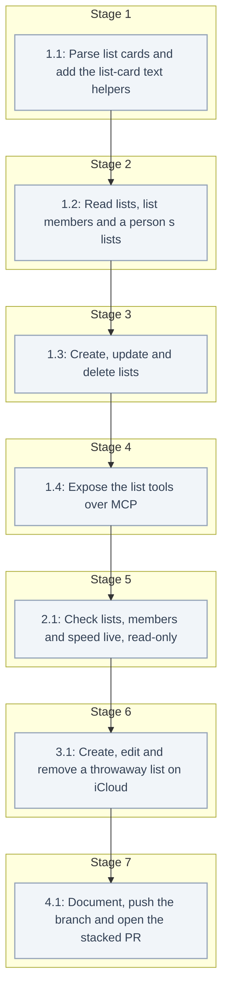

# Tasks: Contacts Lists

<!-- spec-nav:start -->
**Spec navigation:** [State](00_state.md) · [Discovery](01_discovery.md) · [Requirements](02_requirements.md) · [Design](03_design.md) · [Tasks](04_tasks.md) · [Execution](05_execution.md)
<!-- spec-nav:end -->

## Stage and Dependency Overview

> [!WARNING]
> Execute dependency stages in order; every task runs sequentially. Stop at the checkpoint before the live write test, which creates and edits a throwaway list and throwaway contacts in the user's iCloud account. Deleting the throwaway list with the new delete tool needs its own explicit yes, because the user's testing rules reserve deletions for the user. No task writes to a real contact or a real list.

## Checklist

- [ ] 1. Contacts lists in the contact tools
  - [ ] 1.1 Parse list cards and add the list-card text helpers
    - In [`src/icloud_mcp/contacts.py`](../../src/icloud_mcp/contacts.py), add `uid: str = ""` and `members: tuple[str, ...] = ()` to `CachedCard` and fill them in `build_card`. `members` holds the values of every `X-ADDRESSBOOKSERVER-MEMBER` property, with or without a group prefix, with `urn:uuid:` (any case) removed.
    - Add the design's text helpers:
      - `_logical_lines(text) -> tuple[list[str], str]`, keeping each logical line's original folding and returning the newline style;
      - `_unfolded(line)`, `_prop_name(line)` and `_member_ref(line)`;
      - `_escape(value)` for vCard 3.0 TEXT (`\`, `,`, `;`);
      - `_folded(line, newline)` at 75 octets, never inside a UTF-8 character;
      - `_rev(now)` producing `REV:YYYY-MM-DDTHH:MM:SSZ` in UTC;
      - `_edit_group(text, *, name, add, remove, now) -> tuple[str, dict]` and `_new_group_text(uid, name, member_uids, now) -> str`.
    - Test them in [`tests/test_contacts.py`](../../tests/test_contacts.py) against list cards in the five layouts measured live:
      - the common layout;
      - no members;
      - an unknown property (`X-APPLE-OL-MAPPING-INFO`);
      - no `REV`;
      - the kind line before `PRODID`.
    - Also test:
      - CRLF, LF and folded lines;
      - group-prefixed and mixed-case member lines;
      - missing references kept;
      - add, remove and both;
      - a no-op returning identical text;
      - a rename with a comma, semicolon and backslash, and a long multi-byte name that needs folding;
      - `REV` updated only when something else changes, and not added when absent;
      - every untouched logical line byte-identical;
      - `_new_group_text` producing the iCloud layout with CRLF and an upper-case UID.
    - **Files:** [`src/icloud_mcp/contacts.py`](../../src/icloud_mcp/contacts.py), [`tests/test_contacts.py`](../../tests/test_contacts.py)
    - **Dependency resolution:** none
    - **Dependency delivery:** none
    - **Depends on:** none
    - **Stage:** 1
    - **Interfaces:** Consumes: raw vCard text as iCloud stores list cards, and the existing `build_card`; Produces: `CachedCard.uid`, `CachedCard.members`, `_edit_group(text: str, *, name: str | None, add: list[str], remove: list[str], now: datetime.datetime) -> tuple[str, dict]` returning the new text and `{"added", "removed", "unchanged"}` as UID lists, and `_new_group_text(uid: str, name: str, member_uids: list[str], now: datetime.datetime) -> str`
    - **Documentation:** docstrings stating why list cards are edited as text rather than re-serialized, the exact changes `_edit_group` may make, and the iCloud layout `_new_group_text` copies
    - **Verification:** `.venv/bin/pytest -q` passes with the new tests; `.venv/bin/ruff check src tests` is clean; the docstrings are reviewed
    - **Estimated effort:** 45–75 minutes
    - **Risk:** medium; a wrong text edit would corrupt a list card, so byte-identity is asserted line by line
    - **Task category:** heavy_reasoning
    - **Delegation:** controller
    - _Requirements: 4.6, 4.7, 4.8, 5.10_
  - [ ] 1.2 Read lists, list members and a person's lists
    - Split `_people` into `_all_cards(session, credentials)` (today's body without the filter) and `_people` (the filter). Add `_Book` with `people`, `groups` and `by_uid`, its `members(group)` and `groups_of()` methods, and `_book(session, credentials)`, as in the design. UIDs are compared case-insensitively.
    - Add `list_groups() -> {"groups": [{"id", "name", "member_count"}], "total"}`, sorted by `(fold(name), id)`.
    - Add `group_id: str | None = None` as the last parameter of `list_contacts`:
      - without it, the code path and the `"list"` fingerprint are unchanged;
      - with it, it is checked with `ensure_icloud_url` before any request, must be in `book.groups` (else "group not found"), pages `book.members(group)` with the existing keys, and uses the fingerprint `"group:" + canonical_url(group_id)`.
    - Add `"groups"` to `CONTACT_FIELDS`, and a `groups_of` mapping to `_project` and `_date_entry`, computed only when the fields include `"groups"` or `"all"`. In `get_contact`, add `contact["groups"]` from `_book` after the existing GET.
    - Test through the `_all_cards` seam:
      - list ordering, counts that skip missing references and duplicates, and an empty book;
      - members with `total`, paging, `fields`, an unknown group and cursors from another list, the unfiltered listing and search;
      - unfiltered output equal to the pre-feature output;
      - `fields=["groups"]` and `["all"]` in list, search and upcoming dates;
      - `get_contact` adding `groups`, and `[]` for a person in no list.
    - **Files:** [`src/icloud_mcp/contacts.py`](../../src/icloud_mcp/contacts.py), [`tests/test_contacts.py`](../../tests/test_contacts.py)
    - **Dependency resolution:** none
    - **Dependency delivery:** none
    - **Depends on:** 1.1
    - **Stage:** 2
    - **Interfaces:** Consumes: `CachedCard.uid` and `CachedCard.members` from task 1.1, and the existing `_cache`, `_page`, `_project`, `_date_entry`, `_fingerprint`, `_decode_cursor` and `canonical_url`; Produces: `_all_cards`, `_Book`, `_book(session, credentials) -> _Book`, `list_groups() -> dict`, `list_contacts(page_size: int = 50, cursor: str | None = None, fields: list[str] | None = None, group_id: str | None = None) -> dict`, and a `groups` key (`[{"id", "name"}]`) in contact reads
    - **Documentation:** docstrings stating that counts and members follow the iPhone (missing references skipped), that UIDs are matched case-insensitively, and that `groups` is read-only
    - **Verification:** `.venv/bin/pytest -q` passes, including the unchanged list, search and upcoming-dates tests; `ruff` is clean; the docstrings are reviewed
    - **Estimated effort:** 45–75 minutes
    - **Risk:** low; additive reads, and the unfiltered path is unchanged
    - **Task category:** code_analysis
    - **Delegation:** controller
    - _Requirements: 1.1, 1.2, 1.3, 1.4, 1.5, 2.1, 2.2, 2.3, 2.4, 2.5, 2.6, 3.1, 3.2, 3.3, 3.4, 6.1_
  - [ ] 1.3 Create, update and delete lists
    - Add `create_group(name, members=None)`, `update_group(group_id, name=None, add=None, remove=None)` and `delete_group(group_id)` to [`src/icloud_mcp/contacts.py`](../../src/icloud_mcp/contacts.py), as in the design.
      - **Shared checks before any request:** names, ids, overlapping ids and an empty update.
      - **Checks against `_book` before any write:** people, the list, a duplicate folded name excluding the list itself, and the card's `X-ADDRESSBOOKSERVER-KIND:group`.
      - **Writes:** create uses `PUT` with `If-None-Match: *`; update uses a GET, `_edit_group`, then `PUT` with `If-Match`, with one retry on 412 only when no `name` is given; delete uses a GET, then `DELETE` with `If-Match`.
      - **Conflicts** raise the design's `ValueError`, and `mark_dirty` runs after every successful write.
    - Test with a fake session that records every request:
      - add, remove, mixed and a no-op (no PUT);
      - unknown, non-person and overlapping ids (no PUT);
      - rename, a duplicate name and a case-only rename;
      - create with and without members, and a create answered with 412;
      - delete, and a person id given as `group_id` (no write);
      - a 412 then success for a membership change, with the device's new member kept;
      - a 412 twice, and a 412 on a rename and on a delete;
      - malformed arguments sending no request;
      - only list URLs ever written.
    - **Files:** [`src/icloud_mcp/contacts.py`](../../src/icloud_mcp/contacts.py), [`tests/test_contacts.py`](../../tests/test_contacts.py)
    - **Dependency resolution:** none
    - **Dependency delivery:** none
    - **Depends on:** 1.2
    - **Stage:** 3
    - **Interfaces:** Consumes: `_edit_group` and `_new_group_text` from task 1.1, `_book` from task 1.2, and the existing `_get_carddav_session`, `_default_addressbook_url`, `ensure_icloud_url` and `_cache.mark_dirty`; Produces: `create_group(name: str, members: list[str] | None = None) -> dict`, `update_group(group_id: str, name: str | None = None, add: list[str] | None = None, remove: list[str] | None = None) -> dict` and `delete_group(group_id: str) -> dict` with the design's return shapes
    - **Documentation:** docstrings stating the validation order, why only membership changes are retried on a conflict, that person cards are never written, and that deleting a list keeps its people
    - **Verification:** `.venv/bin/pytest -q` passes with the new tests; `ruff` is clean; the docstrings are reviewed
    - **Estimated effort:** 60–90 minutes
    - **Risk:** medium; writes to the user's iCloud, so every write path asserts its target URL and its conditional header
    - **Task category:** heavy_reasoning
    - **Delegation:** controller
    - _Requirements: 4.1, 4.2, 4.3, 4.4, 4.5, 4.9, 4.10, 4.11, 5.1, 5.2, 5.3, 5.4, 5.5, 5.6, 5.7, 5.8, 5.9, 5.11, 6.2, 6.4, 6.5_
  - [ ] 1.4 Expose the list tools over MCP
    - In [`src/icloud_mcp/server.py`](../../src/icloud_mcp/server.py), add the `GroupId` and `MemberIds` annotations and:
      - `contacts_groups`, read-only;
      - `contacts_group_create`, a write;
      - `contacts_group_update` and `contacts_group_delete`, destructive;
      - `group_id` as the last parameter of `contacts_list`.
    - Descriptions call them Contacts lists (groups), say that members are contact ids and that deleting a group keeps its people, and add `groups` to the read-only keys of `contacts_get` and `contacts_update`.
    - In [`tests/test_server.py`](../../tests/test_server.py):
      - keep `contacts_create`, `contacts_delete`, `contacts_search` and `contacts_upcoming_dates` pinned, adding the last to the pinned set before changing anything;
      - re-pin `contacts_list`, `contacts_get` and `contacts_update` after reviewing their diffs;
      - add tests for the new schemas, annotations and descriptions, and for a call through the protocol.
    - **Files:** [`src/icloud_mcp/server.py`](../../src/icloud_mcp/server.py), [`tests/test_server.py`](../../tests/test_server.py)
    - **Dependency resolution:** none
    - **Dependency delivery:** none
    - **Depends on:** 1.3
    - **Stage:** 4
    - **Interfaces:** Consumes: `list_groups`, `list_contacts(group_id=…)`, `create_group`, `update_group` and `delete_group` from tasks 1.2 and 1.3; Produces: the four MCP tools and the `group_id` parameter of `contacts_list`
    - **Documentation:** the tool and parameter descriptions
    - **Verification:** `.venv/bin/pytest -q` passes with the protocol tests; `ruff` is clean; the descriptions are reviewed
    - **Estimated effort:** 30–45 minutes
    - **Risk:** low; the schema changes are additive and pinned
    - **Task category:** code_analysis
    - **Delegation:** controller
    - _Requirements: 3.5, 6.6, 6.7, 7.1, 7.2_

- [ ] 2. Live verification
  - [ ] 2.1 Check lists, members and speed live, read-only
    - Write `.specs/contacts-lists/execution/live_check.py`. Writes are refused before any request and self-checked, and only aggregates are printed. It does the following:
      - compares `list_groups` names, ids and counts with an independent parse of the raw vCards (regular expressions over `X-ADDRESSBOOKSERVER-KIND`, `X-ADDRESSBOOKSERVER-MEMBER` and `UID`, without `build_card`);
      - pages every list's members and compares their ids with the same parse;
      - checks `groups` on every person against it;
      - times 10 warm `contacts_groups` calls and a warm `contacts_get`;
      - records output bytes.
    - Record the results in `.specs/contacts-lists/execution/live-results.md`.
    - **Files:** `.specs/contacts-lists/execution/live_check.py`, `.specs/contacts-lists/execution/live-results.md`
    - **Dependency resolution:** none
    - **Dependency delivery:** none
    - **Depends on:** 1.4
    - **Stage:** 5
    - **Interfaces:** Consumes: `list_groups`, `list_contacts(group_id=…)`, `get_contact` and CardDAV read access through the local credentials file; Produces: `live-results.md` with the comparison counts, the timings (median and maximum) and the sizes
    - **Documentation:** a module docstring stating that the harness is read-only and prints aggregates only
    - **Verification:**
      - every list, count, member page and person's `groups` matches the independent parse;
      - every warm `contacts_groups` call is under 0.5 s;
      - only read methods are issued.
    - **Estimated effort:** 30–45 minutes
    - **Risk:** low; read-only
    - **Task category:** review
    - **Delegation:** controller
    - _Requirements: 1.1, 1.2, 1.3, 1.4, 2.1, 2.2, 2.3, 6.1, 6.3_

- [ ] 3. Checkpoint — live write test on a throwaway list
  - [ ] 3.1 Create, edit and remove a throwaway list on iCloud
    - Only with the user's explicit yes, using the real tool functions:
      1. Record every card's ETag.
      2. Create two throwaway contacts ("ZZ MCP List Test 1" and "ZZ MCP List Test 2"), or reuse existing throwaway cards.
      3. Create the list "ZZ MCP List Test" with contact 1.
      4. Add contact 2, then remove contact 1.
      5. Rename the list to "ZZ MCP List Test Renamed".
      6. Check each step on the iPhone, through iPhone Mirroring or the user's screenshots.
      7. Delete the list with `contacts_group_delete` only after a separate yes; otherwise the user deletes it on the iPhone, and the next `contacts_groups` call must no longer return it.
      8. Compare ETags: only the throwaway list and contacts changed.
    - The user deletes the throwaway contacts.
    - **Files:** `.specs/contacts-lists/execution/write-check.md`
    - **Dependency resolution:** none
    - **Dependency delivery:** none
    - **Depends on:** 2.1
    - **Stage:** 6
    - **Interfaces:** Consumes: the four list tools and `contacts_create` from tasks 1.3 and 1.4; Produces: `write-check.md` recording each step, what the iPhone showed, and the ETag comparison
    - **Documentation:** `write-check.md`
    - **Verification:**
      - each step shows on the iPhone as requested;
      - no other card's ETag changed;
      - the list card's untouched lines are byte-identical before and after each edit;
      - deleting the list leaves the throwaway contacts in place.
    - **Estimated effort:** 30–60 minutes
    - **Risk:** medium; writes to the user's iCloud account, limited to throwaway data and gated by the user's yes
    - **Task category:** review
    - **Delegation:** controller
    - _Requirements: 4.1, 4.2, 5.1, 5.5, 5.6, 5.7, 5.10, 6.2_

- [ ] 4. Delivery
  - [ ] 4.1 Document, push the branch and open the stacked PR
    - In [`README.md`](../../README.md), add rows for the four list tools, a note on `group_id` in `contacts_list` and on the `groups` key, and a note that `contacts_get` costs a full download when `CONTACTS_CACHE=false`.
    - Push `feature/contacts-lists` and open a pull request against `feature/contacts-upcoming-dates` describing the tools, the verification and an example assistant instruction.
    - **Files:** [`README.md`](../../README.md)
    - **Dependency resolution:** none
    - **Dependency delivery:** none
    - **Depends on:** 3.1
    - **Stage:** 7
    - **Interfaces:** Consumes: `live-results.md`, `write-check.md` and the tools from task 1.4; Produces: updated docs and a pull request URL
    - **Documentation:** the README rows and notes
    - **Verification:** `.venv/bin/pytest -q` and `ruff` pass on the pushed head; the pull request exists with the correct base and description
    - **Estimated effort:** 20–30 minutes
    - **Risk:** low
    - **Task category:** quick_lookup
    - **Delegation:** controller
    - _Requirements: 7.3_

## Delivery Schedule

| Stage | Task | Estimate | Depends on | Critical path |
|---:|---|---|---|---|
| 1 | 1.1 | 45–75 min | none | yes |
| 2 | 1.2 | 45–75 min | 1.1 | yes |
| 3 | 1.3 | 60–90 min | 1.2 | yes |
| 4 | 1.4 | 30–45 min | 1.3 | yes |
| 5 | 2.1 | 30–45 min | 1.4 | yes |
| 6 | 3.1 | 30–60 min | 2.1 | yes |
| 7 | 4.1 | 20–30 min | 3.1 | yes |

The total sequential effort is about 4.5–7 hours. The one checkpoint is the live write test, because it writes to the user's iCloud account.
