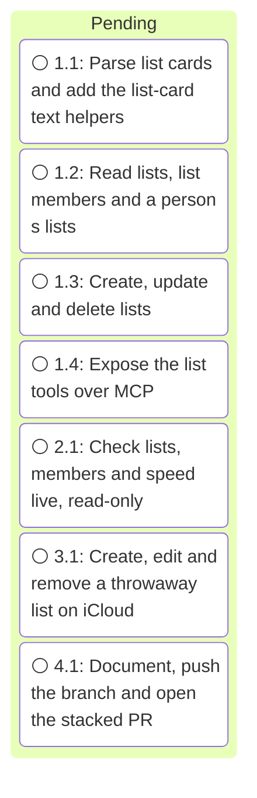

# Execution Ledger: Contacts Lists

<!-- spec-nav:start -->
**Spec navigation:** [State](00_state.md) · [Discovery](01_discovery.md) · [Requirements](02_requirements.md) · [Design](03_design.md) · [Tasks](04_tasks.md) · [Execution](05_execution.md)
<!-- spec-nav:end -->

## Active Wave

| Task | Stage | Mode | Branch / worktree | State |
|---:|---:|---|---|---|
| 3.1 | 6 | controller | `feature/contacts-lists` / main checkout | blocked: waiting for the user's explicit yes before any iCloud write |

| Task | Status | Commit / diff | Verification | Reviewer | Notes |
|---|---|---|---|---|---|
| 1.1 | verified | `525ddec` | 342 tests pass (32 new); ruff clean; folding, `REV` and case-matching mutants each fail tests | controller self-check; wave review pass | List cards are edited as text, so untouched lines stay byte-identical |
| 1.2 | verified | `12db479` | 352 tests pass; the three `["all"]` tests now expect `groups`, and the test seams moved from `_people` to `_all_cards`; ruff clean | controller self-check; wave review pass | `["all"]` and `["groups"]` make one change check per call |
| 1.3 | verified | `48bb4fb` | 386 tests pass; eight mutants (no retry, retry on rename, no list re-check, no `If-Match`, no overlap check, exact-case UIDs, no 412 on create, duplicate-name self-match) each fail tests; ruff clean | controller self-check; wave review pass | The fake CardDAV server now enforces `If-Match` and `If-None-Match` and records write headers |
| 1.4 | verified | `a7b6046` | 389 tests pass; `contacts_create`, `contacts_delete`, `contacts_search` and `contacts_upcoming_dates` keep their digests; `contacts_list` (adds `group_id` only), `contacts_get` and `contacts_update` (description only) re-pinned after diff review | controller self-check; wave review pass | — |
| 2.1 | verified | `aeee334` | [live-results.md](execution/live-results.md): all 15 lists, every member page and all 1,798 people's `groups` match an independent parse; warm `contacts_groups` median 175 ms, max 237 ms; `contacts_groups` 2,425 bytes; only read methods | controller | First run: 3 lists and 2 people disagreed. The cause was 2 UIDs holding vCard escapes. Reads were right, but the write path compared escaped text; fixed test-first in the same commit |
| 3.1 | blocked | — | — | — | Waiting for the user's explicit yes |
| 4.1 | pending | — | — | — | — |

## Baseline

| Revision | Command | Exit | Pre-existing failures |
|---|---|---:|---|
| `18c684c413d72d0df6b0f93c2e00bd26b66df65b` | `.venv/bin/pytest -q` (310 passed) and `.venv/bin/ruff check src tests` | 0 | none |

Work happens on `feature/contacts-lists`, stacked on `feature/contacts-upcoming-dates` at the user's request, in the main checkout. The tree was clean at the base commit.

## Preflight

- **Depth:** thorough. The feature adds public tools that write to and delete from the user's iCloud address book.
- **Review fan-out:** 2 reviewers at `balanced` tier with `high` reasoning, and 2 repair rounds per defect.
- **Artifact digest** (SHA-256 of [01_discovery.md](01_discovery.md) through [04_tasks.md](04_tasks.md)): `da315928aff2299fc238b4333fda29536681e547647baf72fc816af8ae3f2272` before hardening, `6e712dc59a01871dafd3f1a548f18cfb632dd85c7f9560c89385fa655762a490` after.
- **Plan hardening:** 2 read-only reviewers, one looking for gaps and adversarial risks and one checking the plan against the code, with no network and no access to the credentials file. They raised 10 findings, none P0. All were applied to the design and tasks, recorded in [00_state.md](00_state.md) change control. One part was narrowed: format characters (Cf) stay allowed in list names, because emoji family names use zero-width joiners. No path was found that writes a person card or sends credentials off iCloud.
- **Ready check:** `spec-check.py --ready` passed with 48 requirements traced and 7 tasks across 7 stages.

## Wave Review (stages 1–4)

Two independent read-only reviewers (`balanced`, `high`; no network, no access to the credentials file) reviewed `18c684c..a7b6046`. Both passed, with fixes in `dc3daea`.

- **Bug review: no defect at 80% confidence or above.** Its 60% concern was that a GET answered without a charset would be decoded as ISO-8859-1 and double-encode non-ASCII list names on the write back. It was fixed anyway, by decoding the list card's bytes as UTF-8, and tested. Live, iCloud does send `charset=UTF-8`.
- **Requirements trace: every in-scope criterion is implemented.** Four tests could not fail and were strengthened, each proven by a mutant:
  - R6.2: own writes are visible when the change report lags;
  - R3.2: a person's lists are ordered ignoring case and accents;
  - R5.4: duplicate names are matched ignoring accents;
  - R6.5: create, delete and the list filter check their arguments before any request.

  R2.3 now has a member list containing a missing reference.

## Execution Timing


### Task Board


### Run Intervals
| Run ID | Started UTC | Stopped UTC | Elapsed Seconds | Outcome |
|---|---|---|---:|---|
| run-20261011T235553Z | 2026-10-11T23:55:53Z | 2026-10-12T00:21:48Z | 1555 | paused at checkpoint |

### Task Attempt Intervals
| Run ID | Stage/Wave | Task | Attempt | Started UTC | Stopped UTC | Elapsed Seconds | Outcome |
|---|---|---|---:|---|---|---:|---|
| run-20261011T235553Z | Stage 1 | 1.1 | 1 | 2026-10-12T00:02:44Z | 2026-10-12T00:05:18Z | 154 | verified |
| run-20261011T235553Z | Stage 2 | 1.2 | 1 | 2026-10-12T00:05:18Z | 2026-10-12T00:08:11Z | 173 | verified |
| run-20261011T235553Z | Stage 3 | 1.3 | 1 | 2026-10-12T00:08:11Z | 2026-10-12T00:11:54Z | 223 | verified |
| run-20261011T235553Z | Stage 4 | 1.4 | 1 | 2026-10-12T00:11:54Z | 2026-10-12T00:13:41Z | 107 | verified |
| run-20261011T235553Z | Stage 5 | 2.1 | 1 | 2026-10-12T00:17:49Z | 2026-10-12T00:21:24Z | 215 | verified |

## Checkpoints

- **Task 3.1, before the live write test:** reached 2026-10-12T00:21:48Z. It needs the user's explicit yes, plus a separate yes to delete the throwaway list with `contacts_group_delete`. No iCloud write has been made in this run.

## Integration Decision

- Pending task 4.1: a new pull request stacked on `feature/contacts-upcoming-dates` ([sohampatwardhan/icloud-mcp#3](https://github.com/sohampatwardhan/icloud-mcp/pull/3)).

### Execution Gantt

```mermaid
gantt
    dateFormat YYYY-MM-DDTHH:mm:ss
    axisFormat %m-%d %H:%M
```
