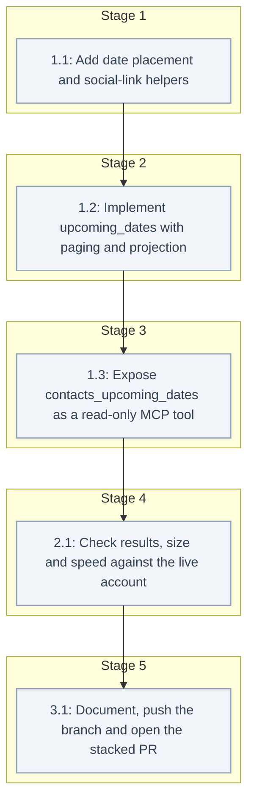

# Tasks: Upcoming Birthdays and Dates

<!-- spec-nav:start -->
**Spec navigation:** [State](00_state.md) · [Discovery](01_discovery.md) · [Requirements](02_requirements.md) · [Design](03_design.md) · [Tasks](04_tasks.md)
<!-- spec-nav:end -->

## Stage and Dependency Overview

## Stage and Dependency Overview

## Checklist

- [ ] 1. The upcoming-dates tool
  - [ ] 1.1 Add date placement and social-link helpers
    - In [`src/icloud_mcp/contacts.py`](../../src/icloud_mcp/contacts.py), add `MAX_WINDOW_DAYS = 366` and the design's helpers:
      - `_month_day(text) -> tuple[int | None, int, int] | None`;
      - `_place(month, day, year) -> datetime.date`, with February 29 falling on February 28 in common years;
      - `_occasions(contact, start, days) -> list[dict]`, which tries both calendar years a window touches. Each result is `{"kind", "date", "days_away"}`, plus `"years"` when the original year is stored and the result is at least 0.
      - `_social_links(contact) -> list[dict[str, str]]`, which keeps web addresses and builds links for `x-apple:` values from `_SOCIAL_SERVICES` with a URL-quoted username; other services get `""`.
    - Test them in [`tests/test_contacts.py`](../../tests/test_contacts.py) on fixed dates:
      - full, yearless, impossible (`--02-30`) and junk values;
      - February 29 placed in 2027 and 2028;
      - a one-day window, a 7-day window across December 31 and a 366-day window;
      - anniversary and custom-labelled dates;
      - `years` with and without a stored year, including a stored year later than the placed year;
      - https links kept, `x-apple:` Snapchat and Instagram links built, an unknown service and a special-character username.
    - **Files:** [`src/icloud_mcp/contacts.py`](../../src/icloud_mcp/contacts.py), [`tests/test_contacts.py`](../../tests/test_contacts.py)
    - **Dependency resolution:** none
    - **Dependency delivery:** none
    - **Depends on:** none
    - **Stage:** 1
    - **Interfaces:** Consumes: contact reads from `_vcard_to_dict` (`birthday`, `dates` as `[{"label", "date"}]`, `social_profiles` as `[{"service", "username", "url"}]`) and `_SOCIAL_SERVICES`; Produces: `_month_day`, `_place`, `_occasions(contact: dict, start: datetime.date, days: int) -> list[dict]` and `_social_links(contact: dict) -> list[dict[str, str]]`
    - **Documentation:** docstrings stating the placement rules (no-year matching, February 29, both years), the meaning of `years`, and why links are derived instead of changing `social_profiles`
    - **Verification:** `.venv/bin/pytest -q` passes with the new tests; `.venv/bin/ruff check src tests` is clean; the docstrings are reviewed
    - **Estimated effort:** 30–45 minutes
    - **Risk:** low; additive private helpers
    - **Task category:** code_analysis
    - **Delegation:** controller
    - _Requirements: 1.1, 1.3, 1.4, 1.5, 1.6, 1.9, 2.2, 2.3, 2.4, 2.5, 2.6_
  - [ ] 1.2 Implement upcoming_dates with paging and projection
    - Add `_today()` (today in `config.DEFAULT_TIMEZONE`), `_date_entry(item, fields)` and `upcoming_dates(start_date=None, days=1, page_size=50, cursor=None, fields=None) -> dict`, as in the design.
      - Validation runs before any request: `days`, then `start_date` (`^\d{4}-\d{2}-\d{2}$` and a real date), page size, fields, and the cursor with `max_rank = days - 1` and the fingerprint `"dates:" + start.isoformat() + ":" + str(days)`.
      - People come from `_people`. Each person with an occasion is keyed `(first days_away, *sort_key, url)`. The response adds `start_date` and `end_date`.
    - Generalise `_page(results, page_size, after, fingerprint, fields, render=_project)`, so list and search keep their output byte for byte.
    - Test through the `_people` and `_today` seams:
      - the default start date, ordering and groups excluded;
      - the default entry keys, named fields, `["all"]` and an unknown field;
      - three pages with `total` and cursors, plus a cursor from another window and one from the list tool;
      - bad `days`, `start_date` and page size raising before any request;
      - a failing `_people` returning nothing.
    - **Files:** [`src/icloud_mcp/contacts.py`](../../src/icloud_mcp/contacts.py), [`tests/test_contacts.py`](../../tests/test_contacts.py)
    - **Dependency resolution:** none
    - **Dependency delivery:** none
    - **Depends on:** 1.1
    - **Stage:** 2
    - **Interfaces:** Consumes: `_occasions`, `_social_links` from task 1.1, and the existing `_people`, `_check_page_size`, `_check_fields`, `_decode_cursor`, `_fingerprint`, `_page` and `_project`; Produces: `upcoming_dates(start_date: str | None = None, days: int = 1, page_size: int = 50, cursor: str | None = None, fields: list[str] | None = None) -> dict` returning `{"contacts", "total", "next_cursor", "start_date", "end_date"}`
    - **Documentation:** a docstring stating the window semantics, the default start date, the entry keys, ordering, paging and the errors
    - **Verification:** `.venv/bin/pytest -q` passes, including the unchanged list and search tests; `ruff` is clean; the docstrings are reviewed
    - **Estimated effort:** 45–75 minutes
    - **Risk:** low; the shared `_page` change is covered by the existing list and search tests
    - **Task category:** code_analysis
    - **Delegation:** controller
    - _Requirements: 1.2, 1.7, 1.8, 2.1, 2.7, 2.8, 3.1, 3.3, 3.4, 3.5, 3.6, 3.8, 4.1, 4.3_
  - [ ] 1.3 Expose contacts_upcoming_dates as a read-only MCP tool
    - First record the schema digests of all six existing contact tools from the unchanged server.
    - Add `contacts_upcoming_dates(start_date, days: Field(ge=1, le=366) = 1, page_size: PageSize = 50, cursor: Cursor = None, fields: DateFields = None) -> dict` to [`src/icloud_mcp/server.py`](../../src/icloud_mcp/server.py) with `READ_ONLY` annotations, a new `DateFields` annotation and a description covering the default start date, the window, the entry keys, the links and paging.
    - Add protocol tests to [`tests/test_server.py`](../../tests/test_server.py):
      - the schema's bounds and defaults;
      - out-of-range `days` and `page_size` rejected before the call;
      - the response through the protocol;
      - the six existing contact tools' digests unchanged.
    - **Files:** [`src/icloud_mcp/server.py`](../../src/icloud_mcp/server.py), [`tests/test_server.py`](../../tests/test_server.py)
    - **Dependency resolution:** none
    - **Dependency delivery:** none
    - **Depends on:** 1.2
    - **Stage:** 3
    - **Interfaces:** Consumes: `contacts.upcoming_dates` from task 1.2 and `contacts.MAX_WINDOW_DAYS`; Produces: the `contacts_upcoming_dates` MCP tool and its schema
    - **Documentation:** the tool description and parameter descriptions
    - **Verification:** `.venv/bin/pytest -q` passes with the protocol tests; `ruff` is clean; the descriptions are reviewed
    - **Estimated effort:** 20–35 minutes
    - **Risk:** low; additive
    - **Task category:** code_analysis
    - **Delegation:** controller
    - _Requirements: 3.2, 3.7, 4.5, 5.1_

- [ ] 2. Live read-only verification
  - [ ] 2.1 Check results, size and speed against the live account
    - Write a read-only harness in `.specs/contacts-upcoming-dates/execution/live_check.py`. Writes are refused and self-checked, and only aggregates are printed. It does the following:
      - times 10 warm calls each for today and a 7-day window;
      - runs all 366 one-day windows, plus a 7-day and a 366-day window, and compares each result's ids with an independent computation over the raw vCards (`BDAY` and `X-ABDATE` read with regular expressions, without `build_card` or `_occasions`);
      - records the largest one-day page in bytes;
      - checks that every Snapchat and Instagram link in results starts with `https://`.
    - Record the results in `.specs/contacts-upcoming-dates/execution/live-results.md`.
    - **Files:** `.specs/contacts-upcoming-dates/execution/live_check.py`, `.specs/contacts-upcoming-dates/execution/live-results.md`
    - **Dependency resolution:** none
    - **Dependency delivery:** none
    - **Depends on:** 1.3
    - **Stage:** 4
    - **Interfaces:** Consumes: `upcoming_dates` and CardDAV read access through the local credentials file; Produces: `live-results.md` with timings (median and maximum), the comparison counts, the largest page and the link check
    - **Documentation:** a module docstring stating that the harness is read-only and prints aggregates only
    - **Verification:**
      - every warm call is under 0.5 s;
      - every window matches the independent computation;
      - the largest one-day page is at most 16,000 bytes;
      - every Snapchat and Instagram link is `https`;
      - only read methods are issued.
    - **Estimated effort:** 30–45 minutes
    - **Risk:** low; read-only
    - **Task category:** review
    - **Delegation:** controller
    - _Requirements: 1.1, 2.9, 4.2, 4.4_

- [ ] 3. Delivery
  - [ ] 3.1 Document, push the branch and open the stacked PR
    - Add a `contacts_upcoming_dates` row and an "Example assistant instruction" section, which is generic and names no specific assistant, to [`README.md`](../../README.md).
    - Push `feature/contacts-upcoming-dates` and open a pull request against `feature/contacts-list-search-scale`, describing the tool, the verification and the suggested Muse instruction.
    - **Files:** [`README.md`](../../README.md)
    - **Dependency resolution:** none
    - **Dependency delivery:** none
    - **Depends on:** 2.1
    - **Stage:** 5
    - **Interfaces:** Consumes: `live-results.md` and the tool from task 1.3; Produces: updated docs and a pull request URL
    - **Documentation:** the README row and the example instruction
    - **Verification:** `.venv/bin/pytest -q` and `ruff` pass on the pushed head; the pull request exists with the correct base and description
    - **Estimated effort:** 20–30 minutes
    - **Risk:** low
    - **Task category:** quick_lookup
    - **Delegation:** controller
    - _Requirements: 5.2_

## Delivery Schedule

| Stage | Task | Estimate | Depends on | Critical path |
|---:|---|---|---|---|
| 1 | 1.1 | 30–45 min | none | yes |
| 2 | 1.2 | 45–75 min | 1.1 | yes |
| 3 | 1.3 | 20–35 min | 1.2 | yes |
| 4 | 2.1 | 30–45 min | 1.3 | yes |
| 5 | 3.1 | 20–30 min | 2.1 | yes |

The total sequential effort is about 2.5–4 hours. There is no checkpoint: nothing in this plan writes to iCloud, and the pull request was approved in discovery.
