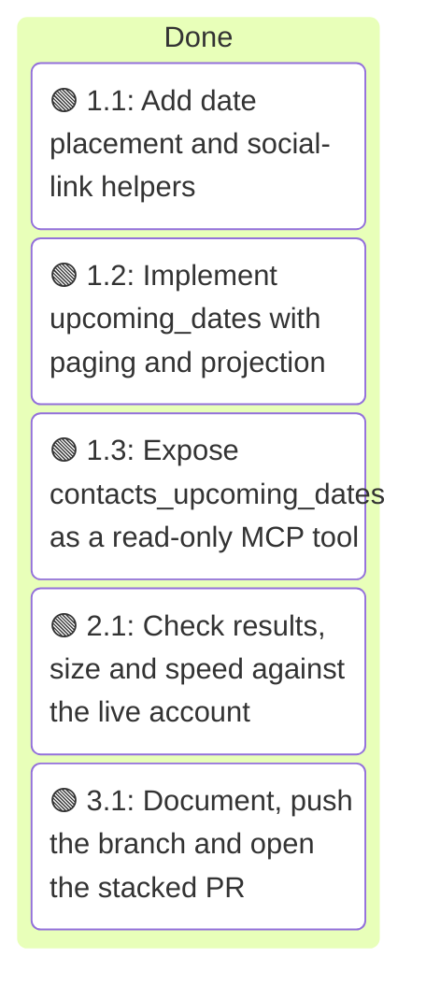
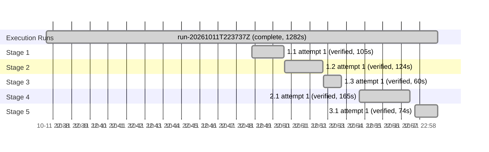

# Execution Ledger: Upcoming Birthdays and Dates

<!-- spec-nav:start -->
**Spec navigation:** [State](00_state.md) · [Discovery](01_discovery.md) · [Requirements](02_requirements.md) · [Design](03_design.md) · [Tasks](04_tasks.md) · [Execution](05_execution.md)
<!-- spec-nav:end -->

## Active Wave

| Task | Stage | Mode | Branch / worktree | State |
|---:|---:|---|---|---|
| — | — | — | `feature/contacts-upcoming-dates` / main checkout | all tasks verified |

| Task | Status | Commit / diff | Verification | Reviewer | Notes |
|---|---|---|---|---|---|
| 1.1 | verified | `512cc0e` | 289 tests pass (20 new); ruff clean | controller self-check; wave review pending | `_place` moves only February 29; other impossible days raise |
| 1.2 | verified | `9a6bee8` | 307 tests pass (18 new, including two real timezones and the cache path); list and search tests unchanged; ruff clean | controller self-check; wave review pending | A blank `start_date` counts as no value, like a blank cursor |
| 1.3 | verified | `d85dcf6` | 310 tests pass (3 new protocol tests); all six existing contact tools keep their pre-feature schema digests; ruff clean | controller self-check; wave review pending | — |
| 2.1 | verified | `c054a7e` | [live-results.md](execution/live-results.md): warm calls 149–220 ms; all 366 one-day windows plus 7- and 366-day windows match an independent parse (1,655 people); busiest day 5,413 bytes, today 2,817; 1,596 Snapchat and 586 Instagram links, all https | controller | A first sweep making one iCloud request per window got a transient HTTP 503 (iCloud then served a 40-call burst normally); the sweep now runs on one live snapshot. A harness regex missed CRLF line ends and was fixed |
| 3.1 | verified | `1b56ac2` | README row and example instruction; 310 tests and ruff pass on the pushed head; [sohampatwardhan/icloud-mcp#3](https://github.com/sohampatwardhan/icloud-mcp/pull/3) open against `feature/contacts-list-search-scale` | controller | The suggested Muse instruction is in the pull request |

## Baseline

| Revision | Command | Exit | Pre-existing failures |
|---|---|---:|---|
| `99011e1a0679b36794c2d98a9b4f3ca8378246ba` | `.venv/bin/pytest -q` (269 passed) and `.venv/bin/ruff check src tests` | 0 | none |

Work happens on `feature/contacts-upcoming-dates`, stacked on `feature/contacts-list-search-scale` at the user's request, in the main checkout. The tree was clean at the base commit.

## Preflight

- **Depth:** medium. The feature adds a public read-only tool and changes one shared paging helper across more than three files; it touches no authentication, migration or dependency.
- **Review fan-out:** 1 reviewer at `balanced` tier with `medium` reasoning, and 2 repair rounds per defect.
- **Artifact digest** (SHA-256 of [01_discovery.md](01_discovery.md) through [04_tasks.md](04_tasks.md)): `906198538362745a6554274cadaea54847aae43e2f13bedfd69c566b5d882b1a`.
- **Hardening result:** 9 findings (2 P1, 7 P2, no P0), all within the approved requirements and applied to the design and tasks:
  - **Timezone:** `_today` goes through `calendar._zone(None)`, so an unknown zone gives the calendar tools' clear error, and it is tested under two zones 25 hours apart.
  - **Real vCards:** tests go through `build_card`, covering the 1604 placeholder year with February 29, the Anniversary label, custom labels and unlabelled dates (kind `other`).
  - **Compact dates** (`--0214`, `19850214`) are read like the dashed forms.
  - **`["all"]` entries** keep `phone` and `email`.
  - **End-date overflow:** a window ending after 9999-12-31 is rejected before any request.
  - **Links:** `x-apple:` and web addresses are matched case-insensitively; usernames lose a leading `@` and are quoted with no safe characters.
  - **More tests:** a protocol test for the tool description, and `contacts_list` and `contacts_search` added to the pinned schema digests.
  - **`years`** is left out only when the stored year is later than the placed year (a data error with no age reached). The occasion itself is still listed.
- **Targeted re-review: fail on two text issues, both fixed.** The link rule was narrowed back to exactly R2.6 (`x-apple:` values), which avoids building a wrong link from a stored value without a scheme. A false claim about `_set_social_profiles` was corrected. Year 0 is no longer treated as "no year".
- **Requirements** are unchanged apart from navigation. The Design and Tasks gates stay approved under delegated authority.
- **Hardened artifact digest:** `d54fb5073fc37b3cc03bc914b3e3e5739b7dfd96f89ad53d017f8bef00ede002`.

## Wave Review (stages 1–3)

One independent reviewer at `balanced` tier: **pass, no defects.** Its one lower-confidence note was applied in `c127cd9`: the tool description now states the `start_date` and `days` defaults itself (R5.1), with a test. The live measurements it could not check from code (R2.9, R4.2) passed in task 2.1.

## Execution Timing

### Task Board

### Run Intervals
| Run ID | Started UTC | Stopped UTC | Elapsed Seconds | Outcome |
|---|---|---|---:|---|
| run-20261011T223737Z | 2026-10-11T22:37:37Z | 2026-10-11T22:58:59Z | 1282 | complete |

### Task Attempt Intervals
| Run ID | Stage/Wave | Task | Attempt | Started UTC | Stopped UTC | Elapsed Seconds | Outcome |
|---|---|---|---:|---|---|---:|---|
| run-20261011T223737Z | Stage 1 | 1.1 | 1 | 2026-10-11T22:48:51Z | 2026-10-11T22:50:36Z | 105 | verified |
| run-20261011T223737Z | Stage 2 | 1.2 | 1 | 2026-10-11T22:50:38Z | 2026-10-11T22:52:42Z | 124 | verified |
| run-20261011T223737Z | Stage 3 | 1.3 | 1 | 2026-10-11T22:52:44Z | 2026-10-11T22:53:44Z | 60 | verified |
| run-20261011T223737Z | Stage 4 | 2.1 | 1 | 2026-10-11T22:54:42Z | 2026-10-11T22:57:27Z | 165 | verified |
| run-20261011T223737Z | Stage 5 | 3.1 | 1 | 2026-10-11T22:57:45Z | 2026-10-11T22:58:59Z | 74 | verified |

## Checkpoints

- None planned: nothing in this feature writes to iCloud.

## Integration Decision

- Status: pull request opened, as chosen in discovery (a new stacked pull request).
- Base: `feature/contacts-list-search-scale` (open as [sohampatwardhan/icloud-mcp#2](https://github.com/sohampatwardhan/icloud-mcp/pull/2), itself stacked on [sohampatwardhan/icloud-mcp#1](https://github.com/sohampatwardhan/icloud-mcp/pull/1)).
- Result: [sohampatwardhan/icloud-mcp#3](https://github.com/sohampatwardhan/icloud-mcp/pull/3). Merging is the user's decision.
- Post-integration verification: 310 tests and ruff pass on the pushed head; the repository has no CI checks configured.

### Execution Gantt

